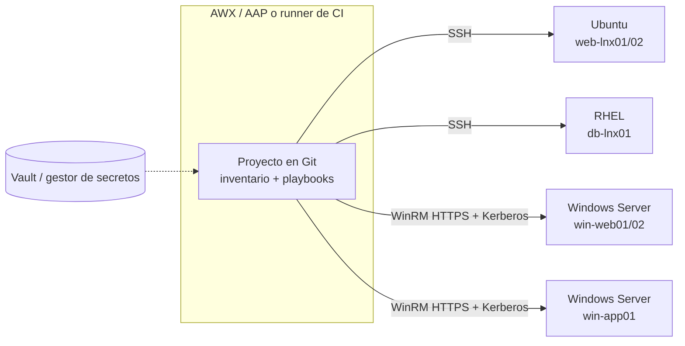

---
tags:
  - servidores
  - ansible
  - linux
  - windows
---

# Ansible en flotas mixtas: casos de uso

> Casos reales con servidores Linux y Windows gestionados desde el mismo proyecto: inventario único, inventario dinámico de AWS, Azure y Google Cloud, playbooks que se adaptan al sistema operativo, parches mensuales por ventanas, usuarios, inventario a CSV, cumplimiento, ejecución programada con AWX/AAP, secretos y cuándo usar otra herramienta.

!!! info "Antes de leer"
    Esta nota junta lo de [Ansible con Linux Server](ansible-linux.md) y [Ansible con Windows Server](ansible-windows.md): conexión, variables y módulos de cada sistema están allí, y los playbooks de un solo sistema en [Recetas de Ansible para servidores](ansible-recetas-servidores.md). Los conceptos (inventario, roles, Vault) en [Configuration management con Ansible](../../devops/iac/ansible.md).

!!! note "Qué se probó"
    Con `ansible-core` 2.21.5: el inventario mixto se validó con `ansible-inventory --graph` y `--host`; los playbooks con `--syntax-check` y `ansible-lint` (perfil `production`); los de usuarios, línea base y CSV se **ejecutaron** contra los dos contenedores Linux de [Ansible con Linux Server](ansible-linux.md) (Ubuntu 24.04 y Rocky 9.8 por SSH). La parte Windows no se ejecutó (sin host Windows). Los plugins de inventario dinámico se comprobaron con `ansible-doc -t inventory` (`amazon.aws` 12.0.0, `azure.azcollection` 4.1.0, `google.cloud` 1.15.0), sin credenciales de nube.

## ¿Qué es una flota mixta?

La mayoría de empresas no tienen "solo Linux": hay servidores web en Ubuntu, bases de datos en RHEL, aplicaciones .NET en Windows Server y controladores de dominio. Gestionarlos con **un solo proyecto de Ansible** da un único inventario, un único sitio para los secretos y un único registro de quién cambió qué.



La clave es separar **dos ejes de grupos**: por **sistema operativo** (cómo conectarse) y por **función o ventana** (qué hacer y cuándo).

## Inventario único con grupos por SO

```text
inventories/prod/
├── hosts.yml
└── group_vars/
    ├── all.yml              # lo común: zona horaria, DNS, contacto
    ├── linux/
    │   └── vars.yml         # SSH, become sudo
    └── windows/
        ├── vars.yml         # WinRM, Kerberos, become runas
        └── vault.yml        # contraseña de la cuenta de servicio (cifrada)
```

```yaml title="inventories/prod/hosts.yml"
all:
  children:
    linux:                         # eje 1: sistema operativo (cómo conectarse)
      children:
        ubuntu:
          hosts:
            web-lnx01:
              ansible_host: 10.20.1.11
            web-lnx02:
              ansible_host: 10.20.1.12
        rhel:
          hosts:
            db-lnx01:
              ansible_host: 10.20.2.11
    windows:
      children:
        win_web:
          hosts:
            win-web01:
              ansible_host: win-web01.corp.ejemplo.com
            win-web02:
              ansible_host: win-web02.corp.ejemplo.com
        win_app:
          hosts:
            win-app01:
              ansible_host: win-app01.corp.ejemplo.com
    web:                           # eje 2: función (qué hace)
      hosts:
        web-lnx01:
        web-lnx02:
        win-web01:
        win-web02:
    ventana_a:                     # eje 3: ventana de mantenimiento (cuándo)
      hosts:
        web-lnx01:
        win-web01:
        win-app01:
    ventana_b:
      hosts:
        web-lnx02:
        win-web02:
        db-lnx01:
```

Las `group_vars` de conexión son las de cada nota: `linux/vars.yml` como en [Ansible con Linux Server](ansible-linux.md#conexion-ssh-con-llave) y `windows/vars.yml` como la pestaña "WinRM + Kerberos" de [Ansible con Windows Server](ansible-windows.md#inventario-y-variables). `windows/vault.yml` guarda `vault_win_password` cifrada con Vault (formato en [Anatomía: archivo cifrado con Ansible Vault](../../recursos/anatomia/ansible.md#archivo-cifrado-con-ansible-vault)).

```bash
ansible-inventory --graph
ansible-inventory --host win-web01
```

```text
@all:
  |--@ungrouped:
  |--@linux:
  |  |--@ubuntu:
  |  |  |--web-lnx01
  |  |  |--web-lnx02
  |  |--@rhel:
  |  |  |--db-lnx01
  |--@windows:
  |  |--@win_web:
  |  |  |--win-web01
  |  |  |--win-web02
  |  |--@win_app:
  |  |  |--win-app01
  |--@web:
  |  |--web-lnx01
  |  |--web-lnx02
  |  |--win-web01
  |  |--win-web02
  |--@ventana_a:
  |  |--web-lnx01
  |  |--win-web01
  |  |--win-app01
  |--@ventana_b:
  |  |--web-lnx02
  |  |--win-web02
  |  |--db-lnx01
{
    "ansible_become_method": "runas",
    "ansible_connection": "winrm",
    "ansible_host": "win-web01.corp.ejemplo.com",
    "ansible_password": "{{ vault_win_password }}",
    "ansible_port": 5986,
    ...
    "vault_win_password": "Ejemplo-NoReal-1"
}
```

!!! danger "`ansible-inventory --host` descifra Vault"
    En la prueba, `--host` mostró en claro el valor de `vault_win_password` (y el resto de variables del `vault.yml`) porque la contraseña de Vault estaba disponible. No lo ejecutes en un pipeline cuyos logs lee mucha gente, ni pegues su salida en un ticket.

Un host puede estar en varios grupos (`win-web01` está en `windows`, `win_web`, `web` y `ventana_a`); sus variables se combinan. Si dos grupos del mismo nivel definen la misma variable con valores distintos, gana el que va después por orden alfabético, salvo que uses `ansible_group_priority`: por eso las variables de conexión van **solo** en los grupos de SO.

## Inventario dinámico de las nubes

Por qué la nube necesita un inventario que se pide a la API del proveedor con un **inventory plugin** está en [Dynamic inventory](../../devops/iac/ansible.md#dynamic-inventory-inventario-dinamico); aquí va la configuración práctica de cada nube. Lo que agrupa son las **tags** (etiquetas) o **labels**: ponlas desde Terraform (`Rol`, `Entorno`, `SO`) y el inventario se organiza solo. El nombre del archivo importa: cada plugin solo lee archivos con un sufijo concreto.

=== "AWS"

    ```yaml title="inventories/nube/prod.aws_ec2.yml"
    plugin: amazon.aws.aws_ec2
    regions:
      - us-east-1
    filters:
      instance-state-name: running
      tag:Entorno: prod
    use_deprecated_tags: false          # usa ec2_tags; "tags" está obsoleto
    hostnames:
      - tag:Name
      - private-ip-address
    compose:
      ansible_host: private_ip_address
    keyed_groups:
      - key: ec2_tags.Rol               # grupos rol_web, rol_db...
        prefix: rol
      - key: platform | default('linux')  # EC2 solo rellena "platform" en Windows
        prefix: so                      # grupos so_windows y so_linux
    ```

    El archivo debe terminar en `aws_ec2.yml`. Credenciales: rol IAM del control node (instance profile) o perfil de AWS CLI; nunca llaves en el archivo.

=== "Azure"

    ```yaml title="inventories/nube/prod.azure_rm.yml"
    plugin: azure.azcollection.azure_rm
    auth_source: auto                   # Managed identity, Azure CLI o variables de entorno
    include_vm_resource_groups:
      - rg-servidores-prod
    conditional_groups:
      windows: os_profile.system == 'windows'
      linux: os_profile.system == 'linux'
    keyed_groups:
      - key: tags.Rol | default('sin_rol')
        prefix: rol
    ```

    El archivo debe terminar en `azure_rm.yml`. Con `include_arc_resource_groups` también incluye servidores on-premise conectados con **Azure Arc**.

=== "Google Cloud"

    ```yaml title="inventories/nube/prod.gcp.yml"
    plugin: google.cloud.gcp_compute
    projects:
      - mi-proyecto-prod
    auth_kind: application              # Application Default Credentials
    filters:
      - status = RUNNING
      - labels.entorno = prod
    hostnames:
      - name
    compose:
      ansible_host: networkInterfaces[0].networkIP   # IP privada
    keyed_groups:
      - key: labels.rol
        prefix: rol
    ```

    El archivo debe terminar en `gcp.yml` o `gcp_compute.yml`.

Los nombres de opciones y los sufijos se comprobaron con `ansible-doc -t inventory <plugin>`:

```text title="ansible-doc -t inventory (extracto real)"
amazon.aws.aws_ec2: The inventory file is a YAML configuration file and must end with
  aws_ec2.{yml|yaml}. For example - my_inventory.aws_ec2.yml.
  The tags host variable is deprecated and will be removed in a release after 2026-12-01.
  Use ec2_tags instead to avoid conflicts with Ansible reserved variable names.
azure.azcollection.azure_rm: Requires a YAML configuration file whose name ends with 'azure_rm.(yml|yaml)'
google.cloud.gcp_compute: Uses a YAML configuration file that ends with gcp_compute.(yml|yaml) or gcp.(yml|yaml).
```

Puedes pasar una **carpeta** con `-i inventories/nube/`: Ansible combina todos los archivos (estático + dinámicos). Y las `group_vars/windows/` siguen funcionando si el plugin crea un grupo llamado `windows`: así una VM nueva en Azure recibe sola la configuración de WinRM.

```bash
ansible-inventory -i inventories/nube/ --graph       # con credenciales de nube configuradas
```

Por qué Terraform crea y Ansible configura: [Ansible vs Terraform](../../devops/iac/ansible.md#ansible-vs-terraform).

## Casos de uso

### Un playbook que se adapta al sistema operativo

Dos técnicas: `when` sobre `ansible_facts['os_family']` dentro de un play, o `group_by` para crear grupos al vuelo y escribir plays separados.

```yaml title="playbooks/site.yml"
---
- name: Línea base común según el sistema operativo
  hosts: linux:windows
  tasks:
    - name: Agrupar por familia de SO en tiempo de ejecución
      ansible.builtin.group_by:
        key: "so_{{ ansible_facts['os_family'] | lower }}"   # so_debian, so_redhat, so_windows

    - name: Paquetes base en Linux
      ansible.builtin.package:
        name: [chrony, rsync]
        state: present
      become: true
      when: ansible_facts['os_family'] in ['Debian', 'RedHat']

    - name: Zona horaria en Windows
      ansible.windows.win_timezone:
        timezone: SA Pacific Standard Time
      when: ansible_facts['os_family'] == 'Windows'

- name: Solo los Debian/Ubuntu detectados
  hosts: so_debian                                           # grupo creado por group_by
  become: true
  tasks:
    - name: Activar las actualizaciones de seguridad automáticas
      ansible.builtin.apt:
        name: unattended-upgrades
        state: present
```

Ejecución real contra los contenedores Linux (sin Windows en ese inventario):

```text
[WARNING]: Could not match supplied host pattern, ignoring: windows
PLAY [Línea base común según el sistema operativo] ***********
TASK [Agrupar por familia de SO en tiempo de ejecución] ******
changed: [srv-ans-ubuntu]
changed: [srv-ans-rocky]
TASK [Paquetes base en Linux] ********************************
ok: [srv-ans-rocky]
ok: [srv-ans-ubuntu]
TASK [Zona horaria en Windows] *******************************
skipping: [srv-ans-ubuntu]
skipping: [srv-ans-rocky]
PLAY [Solo los Debian/Ubuntu detectados] *********************
TASK [Activar las actualizaciones de seguridad automáticas] **
changed: [srv-ans-ubuntu]
PLAY RECAP ***************************************************
srv-ans-rocky  : ok=3  changed=1  unreachable=0  failed=0  skipped=1
srv-ans-ubuntu : ok=5  changed=2  unreachable=0  failed=0  skipped=1
```

Los facts de Windows (`ansible_facts['os_family'] == 'Windows'`) los recoge el módulo `ansible.windows.setup` automáticamente: no hace falta nada especial. Con `when` el playbook es corto pero se llena de condiciones; con `group_by` o con **roles por SO** (`roles/base_linux`, `roles/base_windows`) queda más limpio cuando las tareas difieren mucho.

### Parches mensuales con ventanas

Un **rolling update** (actualización gradual) parchea los servidores por tandas para que el servicio siga disponible. Aquí está el patrón completo; las tareas propias de cada sistema están en las recetas de [Linux](ansible-recetas-servidores.md#parches-con-rolling-update) y [Windows](ansible-recetas-servidores.md#windows-updates-por-lotes-con-reinicio).

| Pieza | Qué hace |
| --- | --- |
| `serial` | Tamaño de cada tanda: un número (`1`), un porcentaje (`"25%"`) o una lista de tandas crecientes |
| `max_fail_percentage` | Porcentaje de hosts fallidos a partir del cual se detiene todo; con `0`, si falla uno no se toca el siguiente |
| Un PLAY por tanda | Ansible repite el play por cada tanda y no empieza la siguiente hasta terminar la anterior (se ve en la [salida real de la receta de Linux](ansible-recetas-servidores.md#parches-con-rolling-update)) |
| Ventanas | Grupos del inventario que dicen **cuándo** se parchea cada servidor |
| Drenado | Sacar el nodo del balanceador antes y devolverlo después, comprobando la salud de la aplicación |

Cada servidor pertenece a una **ventana de mantenimiento** (`ventana_a`, `ventana_b`) acordada con negocio; los nodos de un mismo servicio van en ventanas distintas para que nunca caigan juntos.

```yaml title="playbooks/parches-mensual.yml"
---
- name: Parches mensuales de la flota mixta
  hosts: "{{ ventana | default('ventana_a') }}"
  serial:                          # tandas crecientes: 1 de prueba, luego 25 % y 50 %
    - 1
    - "25%"
    - "50%"
  max_fail_percentage: 10
  tasks:
    - name: Sacar el nodo del balanceador
      ansible.builtin.include_tasks: tareas/drenar.yml

    - name: Parches en Linux
      when: ansible_facts['os_family'] in ['Debian', 'RedHat']
      become: true
      block:
        - name: Actualizar paquetes (apt)
          ansible.builtin.apt:
            upgrade: dist
            update_cache: true
          when: ansible_facts['os_family'] == 'Debian'

        - name: Actualizar paquetes (dnf)
          ansible.builtin.dnf:
            name: "*"
            state: latest # noqa: package-latest
            update_only: true
          when: ansible_facts['os_family'] == 'RedHat'

        - name: Ver si hace falta reiniciar
          ansible.builtin.shell: |
            if [ -f /var/run/reboot-required ]; then exit 1; fi
            if command -v needs-restarting >/dev/null; then needs-restarting -r >/dev/null || exit 1; fi
            exit 0
          register: parches_check
          changed_when: false
          failed_when: parches_check.rc not in [0, 1]

        - name: Reiniciar Linux
          ansible.builtin.reboot:
            reboot_timeout: 900
          when: parches_check.rc == 1

    - name: Parches en Windows (reinicia solo si hace falta)
      ansible.windows.win_updates:
        category_names: [SecurityUpdates, CriticalUpdates, UpdateRollups]
        reboot: true
        reboot_timeout: 3600
      when: ansible_facts['os_family'] == 'Windows'

    - name: Volver a meter el nodo en el balanceador
      ansible.builtin.include_tasks: tareas/reincorporar.yml
```

```bash
ansible-playbook playbooks/parches-mensual.yml -e ventana=ventana_a    # primer sábado
ansible-playbook playbooks/parches-mensual.yml -e ventana=ventana_b    # segundo sábado
```

- `serial` como **lista** hace un *canary* (canario): primero un servidor, y si va bien, tandas más grandes. Más estrategias en [Despliegue continuo](../../devops/ci-cd/despliegue-continuo.md).
- `drenar.yml` y `reincorporar.yml` llaman al módulo de tu balanceador (por ejemplo `community.aws.elb_target` o la API del F5/HAProxy) y comprueban la salud de la aplicación.
- El bloque de Linux condensa en un `shell` las dos comprobaciones de reinicio (`/var/run/reboot-required` y `needs-restarting -r`) que la [receta de Linux](ansible-recetas-servidores.md#parches-con-rolling-update) hace por separado y con su salida real; las opciones de `win_updates` (categorías, `reject_list`, WSUS) están en la [receta de Windows](ansible-recetas-servidores.md#windows-updates-por-lotes-con-reinicio).
- Antes de la ventana, ejecuta en modo informe: `--check` en Linux y `win_updates` con `state: searched` en Windows, y adjunta la lista al **cambio** aprobado (ver [Gestión de servicios e ITIL](../../negocio/gestion-servicios-itil.md)).

### Alta y baja de usuarios en los dos sistemas

```yaml title="playbooks/usuarios.yml"
---
- name: Alta y baja de usuarios en Linux y Windows
  hosts: linux:windows
  vars:
    usuarios:
      - nombre: mlopez
        estado: present
        llave: ssh-ed25519 AAAAC3NzaC1lZDI1NTE5AAAAIExampleKeyOnlyForDocs mlopez
      - nombre: jperez
        estado: absent                     # baja: se borra en todos los servidores
  tasks:
    - name: Usuarios en Linux
      when: ansible_facts['os_family'] != 'Windows'
      become: true
      block:
        - name: Crear o borrar la cuenta
          ansible.builtin.user:
            name: "{{ item.nombre }}"
            state: "{{ item.estado }}"
            remove: "{{ item.estado == 'absent' }}"   # en la baja borra también su home
            shell: /bin/bash
          loop: "{{ usuarios }}"
          loop_control:
            label: "{{ item.nombre }} ({{ item.estado }})"

        - name: Autorizar la llave de los usuarios activos
          ansible.posix.authorized_key:
            user: "{{ item.nombre }}"
            key: "{{ item.llave }}"
          loop: "{{ usuarios | selectattr('estado', 'equalto', 'present') }}"
          loop_control:
            label: "{{ item.nombre }}"

    - name: Usuarios en Windows (cuentas locales)
      ansible.windows.win_user:
        name: "{{ item.nombre }}"
        state: "{{ item.estado }}"
        password: "{{ lookup('ansible.builtin.password', '/dev/null', length=24) if item.estado == 'present' else omit }}"
        update_password: on_create         # contraseña aleatoria solo al crearla
        password_expired: true             # obliga a cambiarla en el primer inicio
      loop: "{{ usuarios }}"
      loop_control:
        label: "{{ item.nombre }} ({{ item.estado }})"
      when: ansible_facts['os_family'] == 'Windows'
      no_log: true
```

```text title="Ejecución real (contenedores Linux)"
TASK [Crear o borrar la cuenta] ******************************
changed: [srv-ans-ubuntu] => (item=mlopez (present))
changed: [srv-ans-rocky] => (item=mlopez (present))
ok: [srv-ans-ubuntu] => (item=jperez (absent))
ok: [srv-ans-rocky] => (item=jperez (absent))
TASK [Autorizar la llave de los usuarios activos] ************
changed: [srv-ans-ubuntu] => (item=mlopez)
changed: [srv-ans-rocky] => (item=mlopez)
TASK [Usuarios en Windows (cuentas locales)] *****************
skipping: [srv-ans-ubuntu] => (item=(censored due to no_log))
...
PLAY RECAP ***************************************************
srv-ans-rocky  : ok=3  changed=2  unreachable=0  failed=0  skipped=1
srv-ans-ubuntu : ok=3  changed=2  unreachable=0  failed=0  skipped=1
```

- `jperez` sale `ok` porque no existía: `absent` es idempotente.
- `loop_control.label` evita que la salida imprima la llave completa de cada usuario.
- En servidores unidos a **Active Directory**, las personas no deberían tener cuentas locales en Windows: gestiona los grupos de AD con `microsoft.ad.group` y deja `win_user` para cuentas de servicio. Lo mismo en Linux si usas SSSD contra AD o un IdP.

### Recolectar el inventario de la flota a un CSV

Útil para auditorías, para el CMDB o para saber cuántos servidores siguen en una versión antigua.

```yaml title="playbooks/facts-csv.yml"
---
- name: Recolectar facts de toda la flota
  hosts: linux:windows
  gather_facts: true
  tasks: []                                  # solo interesa el gather_facts

- name: Escribir el inventario en un CSV
  hosts: localhost
  gather_facts: false
  vars:
    csv_destino: "{{ playbook_dir }}/../informes/inventario-servidores.csv"
  tasks:
    - name: Crear la carpeta de informes
      ansible.builtin.file:
        path: "{{ csv_destino | dirname }}"
        state: directory
        mode: "0755"

    - name: Generar el CSV desde los facts
      ansible.builtin.template:
        src: templates/inventario.csv.j2
        dest: "{{ csv_destino }}"
        mode: "0644"
```

```jinja title="playbooks/templates/inventario.csv.j2"
host,os_family,distribucion,version,kernel,cpus,ram_mb,ip



{{ h }},{{ f['os_family'] }},{{ f['distribution'] }},{{ f['distribution_version'] }},{{ f['kernel'] }},{{ f['processor_vcpus'] | default(f['processor_count']) }},{{ f['memtotal_mb'] }},{{ ip }}

```

```text title="informes/inventario-servidores.csv (salida real)"
host,os_family,distribucion,version,kernel,cpus,ram_mb,ip
srv-ans-rocky,RedHat,Rocky,9.8,5.15.146.1-microsoft-standard-WSL2,20,7746,172.21.0.3
srv-ans-ubuntu,Debian,Ubuntu,24.04,5.15.146.1-microsoft-standard-WSL2,20,7746,172.21.0.2
```

El kernel, las CPU y la RAM son los del host de Docker (los contenedores comparten kernel); en VMs verías los de cada una. En Windows, `default_ipv4` no existe y la plantilla usa la primera de `ip_addresses`. La primera versión de este playbook escribía el CSV con `run_once` y una línea de 295 caracteres: `ansible-lint` la rechazó (`run-once[task]` y `yaml[line-length]`), de ahí el segundo play en `localhost` y la plantilla aparte.

### Cumplimiento: auditar y corregir la desviación

La configuración segura (CIS, STIG, baseline propia) se aplica con roles y se **verifica** periódicamente. Dos usos del mismo playbook:

```bash
ansible-playbook hardening.yml --check --diff     # auditoría: qué se ha desviado, sin tocar nada
ansible-playbook hardening.yml                     # remediación: volver a la baseline
```

Una ejecución programada en `--check` que reporta `changed>0` es una alerta de **drift** (desviación). Roles listos para usar (ansible-lockdown, devsec.hardening), excepciones y verificación en CI en [Hardening como código](../../devsecops/hardening/hardening-como-codigo.md); el marco general en [Cumplimiento y gobierno](../../devsecops/gobierno-y-respuesta/cumplimiento.md). Practícalo en el [Lab 22](../../laboratorios/devsecops/hardening-linux-ansible.md).

### Ejecución programada y auditable con AWX o Ansible Automation Platform

Ejecutar playbooks desde el portátil de alguien no deja rastro ni escala. Un **controller** (controlador) centraliza la ejecución:

| Pieza | Qué aporta |
| --- | --- |
| **Projects** | El repositorio Git con los playbooks (sincroniza una rama o tag) |
| **Inventories** | Inventarios estáticos y dinámicos (AWS, Azure, Google Cloud) que se refrescan solos |
| **Credentials** | Llaves SSH, cuentas de Windows, credenciales de nube y de Vault guardadas cifradas; quien lanza el job no las ve |
| **Job templates** | Playbook + inventario + credenciales + variables: "Parches ventana A" con un botón |
| **Schedules** | Programación (el primer sábado del mes a las 02:00) |
| **RBAC** | Quién puede ver, lanzar o editar cada template |
| **Logs de jobs y notificaciones** | Quién ejecutó qué, cuándo y con qué resultado; aviso a Slack, Teams o correo |
| **Workflows y aprobaciones** | Encadenar templates (parchear, verificar, notificar) con un paso de aprobación |

| Opción | Qué es |
| --- | --- |
| **Red Hat Ansible Automation Platform** (AAP) | Producto comercial con soporte; incluye el controller, Event-Driven Ansible y *execution environments* (imágenes de contenedor con `ansible-core` y colecciones) |
| **AWX** | Proyecto open source upstream de AAP. Su README indica que las releases están **pausadas** durante una gran refactorización (la última fue el 2 de julio de 2024): tenlo en cuenta antes de adoptarlo |
| **Semaphore UI** | Interfaz web open source más ligera para lanzar y programar playbooks |
| **Pipeline de CI/CD** | Un job de GitHub Actions o GitLab CI que ejecuta `ansible-playbook` con credenciales del gestor de secretos; ver [Integración continua](../../devops/ci-cd/integracion-continua.md) y [Seguridad del pipeline](../../devsecops/identidades-y-pipeline/seguridad-pipeline.md) |

### Secretos: Ansible Vault y gestores externos

- **Ansible Vault** cifra `vault.yml` en el repositorio; la contraseña de Vault vive en el controller o en el gestor de secretos del pipeline. Detalle en la [nota de Ansible](../../devops/iac/ansible.md#ansible-vault).
- Con muchos equipos, mejor **leer el secreto en tiempo de ejecución** desde un gestor central con un *lookup*:

| Gestor | Lookup | Ejemplo |
| --- | --- | --- |
| AWS Secrets Manager | `amazon.aws.secretsmanager_secret` | `"{{ lookup('amazon.aws.secretsmanager_secret', 'prod/win/svc-ansible') }}"` |
| Azure Key Vault | `azure.azcollection.azure_keyvault_secret` | `"{{ lookup('azure.azcollection.azure_keyvault_secret', 'svc-ansible', vault_url=kv_url) }}"` |
| Google Secret Manager | `google.cloud.gcp_secret_manager` | `"{{ lookup('google.cloud.gcp_secret_manager', key='svc-ansible') }}"` |
| HashiCorp Vault | colección `community.hashi_vault` | lookup `community.hashi_vault.vault_kv2_get` |

```yaml title="group_vars/windows/vars.yml (secreto desde Key Vault)"
ansible_password: "{{ lookup('azure.azcollection.azure_keyvault_secret', 'svc-ansible', vault_url='https://kv-prod.vault.azure.net') }}"
```

El control node se autentica en el gestor con su identidad de nube (rol IAM, managed identity, service account), no con otra contraseña. Rotación y OIDC en [Secretos e identidades](../../devsecops/identidades-y-pipeline/secretos-identidades.md).

## Ansible frente a otras herramientas para servidores

| Tarea | Ansible | AWS Systems Manager / Azure Update Manager, Azure Machine Configuration / Google Cloud VM Manager (OS Config) | Terraform |
| --- | --- | --- | --- |
| Crear VMs, redes, discos | Puede, pero sin state | No | **Sí: es su función** |
| Configurar el SO (paquetes, archivos, servicios) | **Sí** | Parcial (State Manager, Machine Configuration, OS policies) | No (solo `user_data` / cloud-init al crear) |
| Parches del SO | **Sí**, con control fino (orden, drenado, verificación) | **Sí**, nativo, con informes de cumplimiento y sin abrir puertos de entrada | No |
| Inventario de software | Facts a CSV o CMDB | **Sí**, nativo | No |
| Servidores on-premise y de varias nubes | **Sí**, el mismo código | Con agente y registro híbrido (SSM hybrid, Azure Arc) | No aplica |
| Necesita conectividad entrante (SSH/WinRM) | Sí (o SSM como transporte) | No: el agente sale hacia la API | No |
| Lógica de orquestación compleja | **Sí** | Limitada (documentos o runbooks) | No |

Regla práctica: **Terraform** crea la VM y sus tags; **Ansible** la configura y la mantiene (sobre todo en flotas mixtas, on-premise o multi-nube); los servicios **nativos** de cada nube son la opción más simple si toda la flota está en esa nube y te basta con parches e inventario. Se combinan bien: Ansible puede usar Session Manager como conexión en AWS, y Terraform puede lanzar Ansible al terminar. Ver [Infrastructure as Code: panorama](../../devops/iac/infraestructura-como-codigo.md) y [Gobernanza](../../cloud/operacion-y-gobierno/gobernanza.md).

## Problemas comunes

| Síntoma | Causa | Solución |
| --- | --- | --- |
| Un host Windows intenta conectarse por SSH | No está en el grupo `windows` (o el inventario dinámico no creó ese grupo), así que no recibe las variables de WinRM | `ansible-inventory --host <host>` para ver sus variables; revisa `conditional_groups` / `keyed_groups` |
| Variables que "cambian solas" entre hosts | El host está en dos grupos que definen la misma variable | Variables de conexión solo en los grupos de SO; `ansible_group_priority` si hace falta |
| `[WARNING]: Could not match supplied host pattern, ignoring: windows` | El patrón incluye un grupo vacío o inexistente en ese inventario | Es un aviso, no un error; revisa el `-i` que usas |
| El inventario dinámico no lee el archivo | Sufijo incorrecto (`aws.yml` en vez de `*.aws_ec2.yml`) o falta la colección / sus librerías (boto3, SDK de Azure, google-auth) | Respeta el sufijo; `ansible-doc -t inventory <plugin>` lista los requisitos |
| Aviso de obsolescencia de `tags` en `aws_ec2` | Desde `amazon.aws` 11.2.0 la variable recomendada es `ec2_tags`; `tags` se elimina en una versión posterior a 2026-12-01 | Cambia `key: tags.Rol` por `ec2_tags.Rol` en `keyed_groups` y pon `use_deprecated_tags: false` |
| `YAML parsing failed: ... found unknown escape character` | Una ruta o usuario de Windows con `\` entre comillas dobles | Ver [Validar sin un host Windows](ansible-windows.md#validar-sin-un-host-windows) |
| Un lote de parches tumba el servicio | Todos los nodos del servicio en la misma tanda | Ventanas por grupo, `serial` y drenado del balanceador |
| `run-once[task]` en `ansible-lint` | `run_once` se comporta distinto con `strategy: free` | Un play aparte en `localhost` para lo que se hace una vez |

## Relación con otras secciones

| Enfoque | Qué se mira desde ahí | Nota |
| --- | --- | --- |
| Servidores (la base) | Lo que se automatiza en cada sistema, hecho a mano | [Fundamentos de Linux Server](../linux/linux-fundamentos-servidor.md), [Windows Server: fundamentos](../windows/windows-server-fundamentos.md), [Administración con PowerShell](../windows/windows-powershell-administracion.md) |
| Servidores (automatización) | Conexión y módulos de cada SO; recetas de un solo sistema | [Ansible con Linux Server](ansible-linux.md), [Ansible con Windows Server](ansible-windows.md), [Recetas de Ansible para servidores](ansible-recetas-servidores.md) |
| Cloud (el control) | VMs, tags y servicios nativos de gestión | [Máquinas virtuales](../../cloud/computo/maquinas-virtuales.md), [Gobernanza](../../cloud/operacion-y-gobierno/gobernanza.md) |
| DevOps (la automatización) | IaC, despliegues por tandas y ejecución desde CI | [Configuration management con Ansible](../../devops/iac/ansible.md), [Infrastructure as Code](../../devops/iac/infraestructura-como-codigo.md), [Despliegue continuo](../../devops/ci-cd/despliegue-continuo.md) |
| DevSecOps (la verificación) | Hardening como código, cumplimiento y secretos | [Hardening como código](../../devsecops/hardening/hardening-como-codigo.md), [Cumplimiento y gobierno](../../devsecops/gobierno-y-respuesta/cumplimiento.md), [Secretos e identidades](../../devsecops/identidades-y-pipeline/secretos-identidades.md) |
| Negocio TI (el porqué) | Ventanas de cambio acordadas y gestión de cambios | [Gestión de servicios e ITIL](../../negocio/gestion-servicios-itil.md) |

## Referencias

- [Ansible: Building an inventory (grupos y variables)](https://docs.ansible.com/ansible/latest/inventory_guide/intro_inventory.html)
- [Ansible: Working with dynamic inventory](https://docs.ansible.com/ansible/latest/inventory_guide/intro_dynamic_inventory.html)
- [Inventory plugin `amazon.aws.aws_ec2`](https://docs.ansible.com/ansible/latest/collections/amazon/aws/aws_ec2_inventory.html)
- [Inventory plugin `azure.azcollection.azure_rm`](https://docs.ansible.com/ansible/latest/collections/azure/azcollection/azure_rm_inventory.html)
- [Inventory plugin `google.cloud.gcp_compute`](https://docs.ansible.com/ansible/latest/collections/google/cloud/gcp_compute_inventory.html)
- [Ansible: Controlling playbook execution (serial)](https://docs.ansible.com/ansible/latest/playbook_guide/playbooks_strategies.html)
- [Módulo `ansible.builtin.group_by`](https://docs.ansible.com/ansible/latest/collections/ansible/builtin/group_by_module.html)
- [Red Hat Ansible Automation Platform](https://www.redhat.com/es/technologies/management/ansible)
- [AWX en GitHub](https://github.com/ansible/awx)
- [Semaphore UI](https://semaphoreui.com/)
- [AWS Systems Manager](https://docs.aws.amazon.com/es_es/systems-manager/latest/userguide/what-is-systems-manager.html)
- [Azure Update Manager](https://learn.microsoft.com/es-es/azure/update-manager/overview)
- [Google Cloud VM Manager](https://cloud.google.com/compute/docs/vm-manager?hl=es-419)
