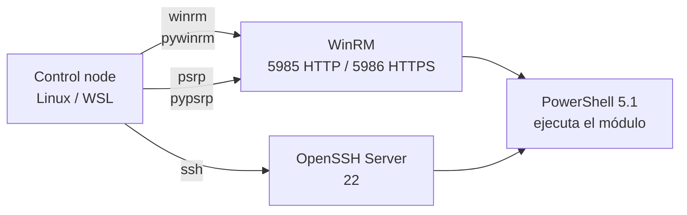

---
tags:
  - servidores
  - ansible
  - windows
  - winrm
---

# Ansible con Windows Server

> Cómo conectar Ansible a servidores Windows: WinRM, PSRP o SSH, autenticación (Kerberos, NTLM, certificados), preparación del host, colecciones y módulos esenciales, casos de uso completos y los errores típicos de conexión.

!!! info "Antes de leer"
    Conviene tener claros los conceptos de Ansible (inventario, playbooks, módulos, `become`) de [Configuration management con Ansible](../../devops/iac/ansible.md) y la administración remota de Windows (PowerShell Remoting, WinRM, OpenSSH Server) de [Windows Server: fundamentos](../windows/windows-server-fundamentos.md#administracion-remota). Si ya conectas Ansible a Linux, [Ansible con Linux Server](ansible-linux.md) es la nota hermana: aquí solo se explica lo que cambia.

!!! warning "Qué se probó y qué no"
    No había un host Windows de pruebas, así que **ningún playbook de esta nota se ejecutó contra Windows**. Todos se validaron con `ansible-playbook --syntax-check`, `ansible-lint` (perfil `production`) y `ansible-doc` (nombres de parámetros) con `ansible-core` 2.21.5 y las colecciones `ansible.windows` 3.9.2, `community.windows` 3.3.0, `microsoft.ad` 1.12.1, `microsoft.iis` 1.3.0 y `chocolatey.chocolatey` 1.6.0. Las salidas contra Windows están marcadas como **salida esperada**; las de validación son reales.

## ¿Qué cambia respecto a Linux?

Ansible sigue siendo **agentless** (sin agente) en Windows, pero casi todo lo de debajo cambia:

| Aspecto | Linux | Windows |
| --- | --- | --- |
| Conexión | SSH | **WinRM** (plugin `winrm`), **PSRP** (plugin `psrp`) o SSH (OpenSSH Server de Windows) |
| Lo que ejecuta en el host | Módulos en Python | Módulos en **PowerShell** (no hace falta Python en el servidor) |
| Módulos | `ansible.builtin.*` | Colecciones `ansible.windows`, `community.windows`, `microsoft.ad`… (casi ningún módulo de `ansible.builtin` funciona en Windows) |
| Escalar privilegios | `become_method: sudo` | `become_method: runas` |
| Autenticación habitual | Llave SSH | Kerberos (dominio), NTLM, certificados o llave SSH |
| Control node | Linux o macOS | **Igual: Linux o macOS.** Ansible no corre de forma nativa en Windows; en un PC con Windows se usa WSL o un contenedor |

Requisitos del **managed node** (nodo gestionado) según la documentación de Ansible: Windows Server 2016 o Windows 10 en adelante, que ya traen PowerShell 5.1, así que no hay que instalar nada para empezar. La matriz de versiones de `ansible-core` 2.21 admite en el nodo gestionado **PowerShell 5.1 a 7** (la 2.20 solo 5.1); el uso de PowerShell 7 tiene su propia página en la documentación. El soporte sigue el ciclo de vida extendido de cada versión de Windows.

## Opciones de conexión: WinRM, PSRP o SSH



| Plugin | Protocolo | Lo bueno | Lo malo | Cuándo |
| --- | --- | --- | --- | --- |
| `winrm` | **WinRM** (*Windows Remote Management*, gestión remota de Windows) sobre HTTP/HTTPS | El valor histórico por defecto; más ejemplos en internet | Más lento; más propenso a timeouts con carga | Entornos que ya lo usan |
| `psrp` | **PSRP** (*PowerShell Remoting Protocol*) sobre WinRM | Según la documentación de Ansible, algo más rápido, menos timeouts bajo carga y mejor soporte de proxy | Mismo puerto y misma preparación que WinRM | Dominio con WinRM ya habilitado: es la opción "WinRM moderna" |
| `ssh` | SSH con OpenSSH Server de Windows | Fácil fuera de dominio, **autenticación con llave**, transferencia de archivos más rápida | Soporte oficial solo desde `ansible-core` 2.18 y con OpenSSH 7.9.0.0 o superior **del que trae Windows**, lo que en la práctica significa **Windows Server 2022 en adelante** | Servidores sin dominio, nuevos, o flotas que ya gestionan todo por SSH |

!!! note "¿Cuál recomienda Ansible?"
    La documentación vigente (revisada en octubre de 2026) **no declara un ganador**: presenta WinRM como lo que Windows trae configurado de serie y SSH como alternativa con soporte oficial desde 2.18. Una regla práctica:

    - **Dominio de Active Directory** → `psrp` (o `winrm`) por **HTTPS** con **Kerberos**.
    - **Servidores sueltos (workgroup) con Windows Server 2022/2025** → `ssh` con llave.
    - Evita mezclar sin motivo: elige una por entorno y documéntala en `group_vars`.

## Autenticación

Con WinRM/PSRP eliges el **transport** (método de autenticación). Tabla de la documentación oficial de Ansible:

| Opción | Cuentas locales | Cuentas de dominio | Delegación de credenciales | Cifrado del mensaje |
| --- | --- | --- | --- | --- |
| Basic | Sí | No | No | No |
| Certificate | Sí | No | No | No |
| NTLM | Sí | Sí | No | Sí |
| Kerberos | No | Sí | Sí | Sí |
| CredSSP | Sí | Sí | Sí | Sí |

- **Kerberos**: la opción recomendada en dominio. No viaja la contraseña, se apoya en tickets del KDC (el controlador de dominio) y permite delegación. Exige usar el **FQDN** del servidor (no la IP) y que el control node resuelva el dominio por DNS.
- **NTLM**: funciona con cuentas locales y de dominio sin configurar Kerberos. Es más débil (y Microsoft lo está retirando progresivamente): úsalo solo con HTTPS y como transición.
- **Certificate**: el usuario se autentica con un certificado cliente asociado a una cuenta **local**. Útil fuera de dominio, pero más laborioso de montar.
- **CredSSP**: envía las credenciales al servidor para resolver el **double hop** (doble salto, ver más abajo). Úsalo solo si de verdad lo necesitas: si el servidor está comprometido, se lleva tus credenciales.
- **Basic**: contraseña en claro dentro del canal. Solo para laboratorio, y nunca por HTTP.

!!! danger "HTTP sin cifrar"
    NTLM, Kerberos y CredSSP cifran el contenido aunque el listener sea HTTP (5985), pero lo recomendable es **HTTPS (5986) con un certificado de tu CA interna**. Activar `AllowUnencrypted` en el servicio WinRM es, según la propia documentación de Ansible, un último recurso para depurar. La configuración de seguridad del host se ve en [Hardening de Windows](../../devsecops/hardening/hardening-windows.md).

Con SSH, la autenticación es la de cualquier servidor SSH: **llave** (recomendada) o contraseña (la menos segura; además necesita `sshpass` en el control node). Las llaves de administradores van por defecto en `C:\ProgramData\ssh\administrators_authorized_keys`.

## Preparar el host Windows

### Listener WinRM por HTTPS

Windows Server ya tiene WinRM activo con un listener HTTP. Para HTTPS necesitas un certificado de servidor emitido para el FQDN (lo normal es pedirlo por **autoenrollment** de AD CS o a tu CA) y crear el listener:

```powershell title="Ejecutar en el servidor Windows como administrador"
# 1. Buscar el certificado de servidor vigente emitido para el FQDN
$fqdn = "$env:COMPUTERNAME.corp.ejemplo.com"
$cert = Get-ChildItem Cert:\LocalMachine\My |
  Where-Object { $_.Subject -eq "CN=$fqdn" -and $_.NotAfter -gt (Get-Date) } |
  Sort-Object NotAfter -Descending | Select-Object -First 1

# 2. Crear el listener HTTPS (puerto 5986) con ese certificado
New-Item -Path WSMan:\localhost\Listener -Transport HTTPS -Address * -CertificateThumbPrint $cert.Thumbprint -Force

# 3. Abrir 5986 solo desde la red de gestión (donde vive el control node)
New-NetFirewallRule -DisplayName "WinRM HTTPS (Ansible)" -Direction Inbound -Protocol TCP -LocalPort 5986 -Profile Domain -RemoteAddress 10.20.0.0/24 -Action Allow

# 4. Comprobar los listeners
Get-ChildItem WSMan:\localhost\Listener | ForEach-Object { Get-ChildItem $_.PSPath }
```

En una flota grande no se hace a mano: se despliega con una **GPO** (Group Policy) que habilita WinRM, el listener y la regla de firewall, o se deja en la imagen base. Ver [Group Policy](../windows/windows-roles-servicios.md#group-policy).

!!! warning "¿Y el script ConfigureRemotingForAnsible.ps1?"
    Muchos tutoriales empiezan descargando `ConfigureRemotingForAnsible.ps1`. Estado actual:

    - Ya **no aparece** en la guía de Windows de la documentación vigente de Ansible, que explica la configuración con comandos de PowerShell como los de arriba.
    - El script se movió del repositorio `ansible/ansible` al repositorio `ansible/ansible-documentation` (carpeta `examples/scripts`); la URL antigua devuelve 404.
    - Su propia cabecera avisa de que usa **certificados autofirmados** y mecanismos de autenticación pensados **solo para desarrollo y evaluación**, y que en producción se usen certificados firmados por una CA y Kerberos.

    Úsalo, si acaso, en un laboratorio desechable. En producción: certificado de tu CA, Kerberos y GPO.

### OpenSSH Server (si eliges SSH)

```powershell title="Ejecutar en el servidor Windows como administrador"
Add-WindowsCapability -Online -Name OpenSSH.Server~~~~0.0.1.0
Set-Service -Name sshd -StartupType Automatic
Start-Service sshd
# Shell por defecto: PowerShell (la documentación de Ansible lo recomienda por estar mejor probado)
New-ItemProperty -Path HKLM:\SOFTWARE\OpenSSH -Name DefaultShell -Value "C:\Windows\System32\WindowsPowerShell\v1.0\powershell.exe" -PropertyType String -Force
```

Detalles de OpenSSH en Windows (regla de firewall, `administrators_authorized_keys` y sus permisos) en [Windows Server: fundamentos](../windows/windows-server-fundamentos.md#openssh-server-en-windows).

## Dependencias del control node

```bash
# Dentro del venv de Ansible
pip install pywinrm                 # plugin winrm (NTLM y Basic incluidos)
pip install "pywinrm[kerberos]"     # + Kerberos (necesita las librerías krb5 del sistema)
pip install "pywinrm[credssp]"      # + CredSSP
pip install "pypsrp[kerberos]"      # plugin psrp con Kerberos (usa pyspnego)
ansible-galaxy collection install -r requirements.yml
```

Para Kerberos instala también el cliente del sistema: `krb5-user` y `libkrb5-dev` en Debian/Ubuntu, `krb5-workstation` y `krb5-devel` en RHEL. Comprueba que funciona **antes** de culpar a Ansible:

```bash
kinit svc-ansible@CORP.EJEMPLO.COM     # pide la contraseña y obtiene un ticket (TGT)
klist                                  # debe mostrar krbtgt/CORP.EJEMPLO.COM@CORP.EJEMPLO.COM
```

```ini title="/etc/krb5.conf (fragmento)"
[libdefaults]
    default_realm = CORP.EJEMPLO.COM
    dns_lookup_kdc = true        ; encuentra los DC por registros SRV del DNS
    dns_lookup_realm = false

[domain_realm]
    .corp.ejemplo.com = CORP.EJEMPLO.COM
```

El **realm** va en **MAYÚSCULAS**: es el error más frecuente al empezar.

```yaml title="requirements.yml"
collections:
  - name: ansible.windows
    version: ">=3.0.0,<4.0.0"
  - name: community.windows
  - name: microsoft.ad
  - name: microsoft.iis
  - name: chocolatey.chocolatey
```

## Inventario y variables

```yaml title="inventories/prod/hosts.yml (fragmento)"
all:
  children:
    windows:
      children:
        win_web:
          hosts:
            win-web01:
              ansible_host: win-web01.corp.ejemplo.com   # FQDN, no IP: Kerberos lo necesita
            win-web02:
              ansible_host: win-web02.corp.ejemplo.com
        win_app:
          hosts:
            win-app01:
              ansible_host: win-app01.corp.ejemplo.com
```

=== "WinRM + Kerberos"

    ```yaml title="inventories/prod/group_vars/windows/vars.yml"
    ---
    ansible_connection: winrm
    ansible_port: 5986
    ansible_winrm_scheme: https
    ansible_winrm_transport: kerberos
    ansible_winrm_server_cert_validation: validate          # nunca "ignore" en producción
    ansible_winrm_ca_trust_path: /etc/pki/ca-trust/source/anchors/corp-root-ca.pem
    ansible_user: svc-ansible@CORP.EJEMPLO.COM              # UPN con el realm en mayúsculas
    ansible_password: "{{ vault_win_password }}"             # cifrada en vault.yml
    ansible_become_method: runas
    ```

=== "PSRP + Kerberos"

    ```yaml title="inventories/prod/group_vars/windows/vars.yml"
    ---
    ansible_connection: psrp
    ansible_port: 5986
    ansible_psrp_protocol: https
    ansible_psrp_auth: kerberos              # por defecto: negotiate (Kerberos y, si no, NTLM)
    ansible_psrp_cert_validation: validate
    ansible_psrp_ca_cert: /etc/pki/ca-trust/source/anchors/corp-root-ca.pem
    ansible_user: svc-ansible@CORP.EJEMPLO.COM
    ansible_password: "{{ vault_win_password }}"
    ansible_become_method: runas
    ```

=== "SSH con llave"

    ```yaml title="inventories/prod/group_vars/windows/vars.yml"
    ---
    ansible_connection: ssh
    ansible_shell_type: powershell           # debe coincidir con el DefaultShell del host
    ansible_user: svc-ansible
    ansible_ssh_private_key_file: ~/.ssh/ansible_win
    ansible_become_method: runas
    ```

| Variable | Para qué | Valores típicos |
| --- | --- | --- |
| `ansible_connection` | Plugin de conexión | `winrm`, `psrp`, `ssh` |
| `ansible_port` | Puerto | `5986` (HTTPS), `5985` (HTTP), `22` (SSH) |
| `ansible_winrm_scheme` / `ansible_psrp_protocol` | HTTP o HTTPS | `https` |
| `ansible_winrm_transport` / `ansible_psrp_auth` | Método de autenticación | `kerberos`, `ntlm`, `certificate`, `credssp` (`negotiate` en psrp) |
| `ansible_winrm_server_cert_validation` / `ansible_psrp_cert_validation` | Validar el certificado del servidor | `validate` (por defecto), `ignore` (solo laboratorio) |
| `ansible_winrm_ca_trust_path` / `ansible_psrp_ca_cert` | CA con la que validar | ruta a un PEM |
| `ansible_winrm_message_encryption` / `ansible_psrp_message_encryption` | Cifrado del mensaje sobre HTTP | `auto`, `always`, `never` |
| `ansible_shell_type` | Shell del host (solo SSH) | `powershell`, `cmd` |
| `ansible_become_method` | Cómo cambiar de usuario | `runas` |

Los nombres de las variables se comprobaron con `ansible-doc -t connection ansible.builtin.winrm` y `ansible.builtin.psrp`.

## Colecciones para Windows

| Colección | Qué trae | Nota |
| --- | --- | --- |
| `ansible.windows` | Lo esencial con soporte de Red Hat: `win_ping`, `win_feature`, `win_service`, `win_package`, `win_updates`, `win_user`, `win_group_membership`, `win_regedit`, `win_copy`, `win_template`, `win_reboot`, `win_dsc`, `win_firewall_rule`, `win_scheduled_task`… | Varios módulos (firewall, tareas programadas, zona horaria…) **se movieron aquí** desde `community.windows` |
| `community.windows` | Módulos de la comunidad: `win_robocopy`, `win_psmodule`, `win_pagefile`, `win_nssm`… | Mantiene redirecciones obsoletas a `ansible.windows` que desaparecen en la 4.0.0; sus módulos `win_iis_*` están **deprecated** (obsoletos) |
| `microsoft.ad` | Active Directory: `membership` (unir al dominio), `domain`, `domain_controller`, `user`, `group`, `ou`, `computer`… | Sustituye a los antiguos `win_domain_*` de `community.windows`, ya eliminados |
| `microsoft.iis` | IIS: `website`, `web_app_pool`, `web_application`, `virtual_directory` | Reemplazo de `community.windows.win_iis_*` |
| `chocolatey.chocolatey` | Paquetes con Chocolatey: `win_chocolatey`, `win_chocolatey_source`… | Útil si tu organización tiene un repositorio interno de Chocolatey |

Comprobado en las colecciones instaladas (`ansible-doc -l` y `meta/runtime.yml` de `community.windows` 3.3.0). Usa siempre el **FQCN** de la colección "buena": `ansible.windows.win_firewall_rule`, no `community.windows.win_firewall_rule`.

## Comprobar la conexión

```bash
ansible windows -m ansible.windows.win_ping
ansible win-web01 -m ansible.windows.setup -a "filter=ansible_os_name,ansible_distribution_version,ansible_powershell_version"
```

```text title="Salida esperada (no ejecutada: sin host Windows)"
win-web01 | SUCCESS => {
    "changed": false,
    "ping": "pong"
}
win-web01 | SUCCESS => {
    "ansible_facts": {
        "ansible_distribution_version": "10.0.20348.0",
        "ansible_os_name": "Microsoft Windows Server 2022 Datacenter",
        "ansible_powershell_version": 5
    },
    "changed": false
}
```

`win_ping` no es un ping ICMP: comprueba que Ansible puede conectarse, autenticarse y ejecutar PowerShell. Si falla, ve a [Problemas comunes](#problemas-comunes).

## Módulos esenciales

| Tarea | Módulo | Equivalente en PowerShell |
| --- | --- | --- |
| Roles y features | `ansible.windows.win_feature` | `Install-WindowsFeature` |
| Servicios | `ansible.windows.win_service` | `Set-Service`, `sc.exe failure` |
| Instalar MSI/EXE | `ansible.windows.win_package` | `msiexec /i … /qn` |
| Windows Update | `ansible.windows.win_updates` | módulo PSWindowsUpdate |
| Usuarios locales | `ansible.windows.win_user` | `New-LocalUser` |
| Grupos locales | `ansible.windows.win_group_membership` | `Add-LocalGroupMember` |
| Registro | `ansible.windows.win_regedit` | `Set-ItemProperty HKLM:\…` |
| Copiar / plantillas | `ansible.windows.win_copy`, `ansible.windows.win_template` | `Copy-Item` |
| Firewall | `ansible.windows.win_firewall_rule` | `New-NetFirewallRule` |
| Tareas programadas | `ansible.windows.win_scheduled_task` | `Register-ScheduledTask` |
| Reiniciar | `ansible.windows.win_reboot` | `Restart-Computer` (y esperar) |
| DSC | `ansible.windows.win_dsc` | recursos de PowerShell DSC |
| Unir al dominio | `microsoft.ad.membership` | `Add-Computer` |

Los comandos de PowerShell equivalentes están explicados en [Administración con PowerShell](../windows/windows-powershell-administracion.md). Un playbook con un ejemplo de cada módulo:

```yaml title="playbooks/win-modulos.yml"
---
- name: Módulos esenciales de Windows
  hosts: windows
  tasks:
    - name: Comprobar la conexión
      ansible.windows.win_ping:

    - name: Instalar 7-Zip con Chocolatey
      chocolatey.chocolatey.win_chocolatey:
        name: 7zip
        version: "24.9.0"                     # fija la versión como en cualquier dependencia
        state: present

    - name: Crear un usuario local de servicio
      ansible.windows.win_user:
        name: svc-backup
        password: "{{ vault_svc_backup_password }}"
        password_never_expires: true
        user_cannot_change_password: true
        groups: [Backup Operators]
        groups_action: add                    # añade sin quitarle otros grupos
        state: present
      no_log: true                            # la contraseña no sale en la salida

    - name: Grupo local de administradores
      ansible.windows.win_group_membership:
        name: Administrators
        members:
          - CORP\GG-Admins-Servidores
        state: present                        # "pure" deja SOLO los de la lista

    - name: Desactivar SMBv1 en el registro
      ansible.windows.win_regedit:
        path: HKLM:\SYSTEM\CurrentControlSet\Services\LanmanServer\Parameters
        name: SMB1
        data: 0
        type: dword

    - name: Copiar un script de mantenimiento
      ansible.windows.win_copy:
        src: files/limpiar-logs.ps1
        dest: C:\Scripts\limpiar-logs.ps1

    - name: Programar el script cada noche
      ansible.windows.win_scheduled_task:
        name: LimpiarLogs
        description: Borra logs de IIS de más de 30 días
        actions:
          - path: powershell.exe
            arguments: -NoProfile -ExecutionPolicy Bypass -File C:\Scripts\limpiar-logs.ps1
        triggers:
          - type: daily
            start_boundary: "2026-01-01T02:30:00"
        username: SYSTEM
        run_level: highest
        state: present

    - name: Zona horaria con DSC
      ansible.windows.win_dsc:
        resource_name: TimeZone               # recurso DSC; el resto son sus propiedades
        IsSingleInstance: "Yes"
        TimeZone: SA Pacific Standard Time

    - name: Ejecutar una tarea como otro usuario (runas)
      ansible.windows.win_shell: Get-ChildItem \\fs01.corp.ejemplo.com\instaladores
      become: true
      become_user: CORP\svc-instalador
      vars:
        ansible_become_password: "{{ vault_instalador_password }}"
      changed_when: false
```

- En YAML, las rutas de Windows **sin comillas** no necesitan escapar `\`. Entre comillas dobles sí (`"C:\\Scripts"`); entre comillas simples no. Para evitar sorpresas, deja las rutas sin comillas o usa comillas simples.
- `win_dsc` necesita que el módulo DSC del recurso esté instalado en el host (`TimeZone` viene en `ComputerManagementDsc`, que se instala con `community.windows.win_psmodule`).
- `win_shell` y `win_command` no son idempotentes: igual que en Linux, usa `creates`, `changed_when` o, mejor, un módulo.

## Casos de uso

### Instalar IIS y publicar un sitio

```yaml title="playbooks/win-iis.yml"
---
- name: Instalar IIS y publicar un sitio
  hosts: win_web
  vars:
    iis_sitio: intranet
    iis_ruta: C:\inetpub\intranet
    iis_puerto: 80
  tasks:
    - name: Instalar el rol Web-Server con sus herramientas
      ansible.windows.win_feature:
        name: Web-Server
        include_management_tools: true
        state: present
      register: iis_feature

    - name: Reiniciar si la instalación lo pide
      ansible.windows.win_reboot:
      when: iis_feature.reboot_required

    - name: Crear la carpeta del sitio
      ansible.windows.win_file:
        path: "{{ iis_ruta }}"
        state: directory

    - name: Publicar la página de inicio
      ansible.windows.win_template:
        src: templates/index.html.j2
        dest: "{{ iis_ruta }}\\index.html"

    - name: Crear el application pool
      microsoft.iis.web_app_pool:
        name: "{{ iis_sitio }}"
        state: started

    - name: Crear el sitio con su binding
      microsoft.iis.website:
        name: "{{ iis_sitio }}"
        physical_path: "{{ iis_ruta }}"
        application_pool: "{{ iis_sitio }}"
        state: started
        bindings:
          set:                                  # lista exacta: quita los bindings que no estén
            - ip: "*"
              port: "{{ iis_puerto }}"
              hostname: intranet.corp.ejemplo.com

    - name: Abrir el puerto HTTP en el firewall
      ansible.windows.win_firewall_rule:
        name: IIS intranet HTTP
        localport: "{{ iis_puerto }}"
        protocol: tcp
        direction: in
        action: allow
        profiles: [domain]
        state: present
        enabled: true

    - name: Comprobar que responde
      ansible.windows.win_uri:
        url: http://localhost:{{ iis_puerto }}/
        headers:
          Host: intranet.corp.ejemplo.com
        return_content: true
      register: iis_respuesta
      failed_when: "'intranet' not in iis_respuesta.content"
```

```text title="Salida esperada (no ejecutada: sin host Windows)"
TASK [Instalar el rol Web-Server con sus herramientas] ****
changed: [win-web01]
changed: [win-web02]
TASK [Reiniciar si la instalación lo pide] ****************
skipping: [win-web01]
skipping: [win-web02]
...
PLAY RECAP ************************************************
win-web01 : ok=8  changed=6  unreachable=0  failed=0  skipped=1
win-web02 : ok=8  changed=6  unreachable=0  failed=0  skipped=1
```

El certificado HTTPS del sitio y la configuración manual de IIS están en [IIS](../windows/windows-roles-servicios.md#iis).

### Windows Updates por lotes con reinicio

```yaml title="playbooks/win-updates.yml"
---
- name: Windows Updates por lotes con reinicio
  hosts: windows
  serial: "25%"                     # de cuatro en cuatro si hay 16 servidores
  max_fail_percentage: 0            # si falla uno, no sigue con el siguiente lote
  tasks:
    - name: Buscar las actualizaciones pendientes (sin instalar)
      ansible.windows.win_updates:
        category_names:
          - SecurityUpdates
          - CriticalUpdates
          - UpdateRollups
        state: searched
      register: upd_pendientes

    - name: Mostrar cuántas hay
      ansible.windows.win_shell: Write-Output "{{ upd_pendientes.found_update_count }} actualizaciones pendientes"
      changed_when: false

    - name: Instalar y reiniciar las veces que haga falta
      ansible.windows.win_updates:
        category_names:
          - SecurityUpdates
          - CriticalUpdates
          - UpdateRollups
        reject_list:
          - KB5034441                   # ejemplo: un KB que tu equipo decidió aplazar
        reboot: true                    # reinicia y continúa hasta terminar
        reboot_timeout: 3600
      register: upd_resultado

    - name: Fallar si alguna no se instaló
      ansible.builtin.assert:
        that: upd_resultado.failed_update_count | default(0) == 0
        fail_msg: "{{ upd_resultado.failed_update_count }} actualizaciones fallaron en {{ inventory_hostname }}"
```

- `state: searched` es el "modo informe": lista sin instalar. Útil para revisar antes de la ventana.
- Con `reboot: true`, el módulo reinicia y vuelve a buscar hasta que no quedan actualizaciones de esas categorías.
- Si los servidores usan **WSUS** o Windows Update for Business, el módulo respeta esa configuración (`server_selection` permite forzar `windows_update`). Las políticas de parcheo están en [Hardening de Windows](../../devsecops/hardening/hardening-windows.md#parches-windows-update-y-wsus).

### Unir servidores a Active Directory

```yaml title="playbooks/win-dominio.yml"
---
- name: Unir servidores Windows al dominio
  hosts: win_app
  vars:
    dominio_fqdn: corp.ejemplo.com
    dominio_ou: OU=Servidores,DC=corp,DC=ejemplo,DC=com
  tasks:
    - name: Apuntar el DNS a los controladores de dominio
      ansible.windows.win_dns_client:
        adapter_names: "*"
        dns_servers:
          - 10.20.0.10
          - 10.20.0.11

    - name: Unir al dominio en la OU de servidores y reiniciar
      microsoft.ad.membership:
        dns_domain_name: "{{ dominio_fqdn }}"
        hostname: "{{ inventory_hostname }}"    # renombra y une en un solo reinicio
        domain_ou_path: "{{ dominio_ou }}"
        domain_admin_user: "{{ vault_join_user }}"
        domain_admin_password: "{{ vault_join_password }}"
        state: domain
        reboot: true
      no_log: true
```

Antes de unirse, el servidor **no está en el dominio**, así que la primera conexión no puede ser Kerberos: usa una cuenta local con NTLM sobre HTTPS (o SSH) para este play, y Kerberos a partir de ahí. Usa una cuenta con permiso **solo** para unir equipos a esa OU (delegación en AD), no un Domain Admin. Los pasos manuales equivalentes (`Add-Computer`) están en [Unir un equipo al dominio](../windows/windows-roles-servicios.md#unir-un-equipo-al-dominio).

### Regla de firewall y servicio de un agente

```yaml title="playbooks/win-firewall-servicio.yml"
---
- name: Regla de firewall y servicio de un agente
  hosts: win_app
  vars:
    agente_msi_url: https://repo.corp.ejemplo.com/agente/agente-2.4.1-x64.msi
    agente_product_id: "{6F1A6B3E-0000-4C2B-9C1D-1234567890AB}"
  tasks:
    - name: Instalar el agente desde un MSI
      ansible.windows.win_package:
        path: "{{ agente_msi_url }}"
        product_id: "{{ agente_product_id }}"   # así sabe si ya está instalado (idempotencia)
        arguments: /qn /norestart
        state: present

    - name: Permitir el puerto del agente solo desde la red de gestión
      ansible.windows.win_firewall_rule:
        name: Agente de monitoreo 9182
        localport: 9182
        protocol: tcp
        direction: in
        action: allow
        remoteip: 10.20.0.0/24
        profiles: [domain, private]
        state: present
        enabled: true

    - name: Servicio en automático con reinicio ante fallos
      ansible.windows.win_service:
        name: AgenteMonitoreo
        start_mode: auto
        state: started
        failure_actions:                        # lo mismo que "sc.exe failure"
          - type: restart
            delay_ms: 5000
          - type: restart
            delay_ms: 30000
        failure_reset_period_sec: 86400
```

Sin `product_id`, `win_package` no puede saber si el MSI ya está instalado y lo descargaría en cada ejecución. Lo obtienes en un equipo donde ya esté instalado, en el registro de desinstalación (`Get-ItemProperty HKLM:\SOFTWARE\Microsoft\Windows\CurrentVersion\Uninstall\*` y la propiedad `PSChildName`). Evita `Win32_Product`: es lento y hace que Windows Installer revise todos los MSI.

## Validar sin un host Windows

Todo lo de esta nota se validó así. Es lo que conviene poner en CI aunque tengas hosts reales:

```bash
ansible-playbook --syntax-check playbooks/win-iis.yml
ansible-lint playbooks/
ansible-doc microsoft.iis.website           # parámetros y ejemplos reales del módulo
ansible-doc -t connection ansible.builtin.psrp
```

```text title="Salida real (proyecto de pruebas con los playbooks de Windows y los mixtos)"
playbook: playbooks/win-iis.yml

Passed: 0 failure(s), 0 warning(s) in 15 files processed of 17 encountered.
Last profile that met the validation criteria was 'production'.
```

`--syntax-check` carga el inventario y descifra `vault.yml` (si tiene la contraseña de Vault), pero **no se conecta** a ningún host. Un error que sí detectó en esta prueba: un usuario escrito como `"CORP\svc-join"` (comillas dobles) da `YAML parsing failed: ... found unknown escape character`, porque `\s` no es un escape válido en YAML. Con comillas simples (`'CORP\svc-join'`) o sin comillas funciona.

Para probar de verdad sin producción: una VM de evaluación de Windows Server (Microsoft ofrece imágenes de evaluación) o una VM en la nube que destruyes al terminar; ver [Máquinas virtuales](../../cloud/computo/maquinas-virtuales.md).

## Problemas comunes

| Síntoma | Causa | Solución |
| --- | --- | --- |
| `ssl: HTTPSConnectionPool(...): Max retries exceeded ... certificate verify failed` | El control node no confía en la CA que firmó el certificado del listener, o el nombre no coincide con el CN/SAN | Pon la CA en `ansible_winrm_ca_trust_path` (o el almacén del sistema) y conecta por el FQDN del certificado. `ignore` solo en laboratorio |
| `the specified credentials were rejected by the server` | Usuario o contraseña mal; la cuenta no está en Administrators; cuenta local bloqueada por **UAC remoto** (`LocalAccountTokenFilterPolicy`); transport no permitido | Revisa el evento **4625** en el servidor (`Get-WinEvent -FilterHashtable @{LogName='Security'; Id=4625} -MaxEvents 1`) y sus códigos de estado; usa una cuenta de dominio con Kerberos |
| `kerberos: ... Server not found in Kerberos database` | Conectas por IP o por un alias sin **SPN** (`HTTP/<fqdn>`); DNS inverso o `/etc/krb5.conf` incorrecto | Usa el FQDN real en `ansible_host`; comprueba con `kinit` y `klist`; revisa el SPN con `setspn -L <equipo>` |
| `kerberos: ... Cannot find KDC for realm` | Realm en minúsculas o el DNS del control node no ve los registros SRV del dominio | Realm en MAYÚSCULAS en el usuario y en `krb5.conf`; usa los DNS del dominio |
| `Clock skew too great` | Más de 5 minutos de diferencia entre control node, servidor y DC | Sincroniza la hora (NTP) en los tres |
| Credenciales rechazadas con `basic` y una cuenta de dominio | Basic solo admite cuentas locales y suele estar deshabilitado en el servicio WinRM | Usa `ntlm` o `kerberos` |
| Error de que `winrm` (pywinrm) o `pypsrp` no está instalado | Falta la librería en el **venv** donde corre Ansible (no en el Python del sistema) | `pip install pywinrm` o `pypsrp` en ese venv |
| `Connection refused` o timeout a 5986 | No hay listener HTTPS, firewall de Windows o un security group / NSG lo bloquea | `winrm enumerate winrm/config/listener` en el host y `Test-NetConnection <host> -Port 5986` desde la red de gestión |
| La tarea funciona en local pero da `Access is denied` al tocar un share o un recurso de red | **Double hop**: con NTLM, Kerberos sin delegación o llave SSH, la sesión remota no tiene credenciales para un segundo salto | `become: true` con `become_method: runas` y un `become_user` con contraseña (como en `win-modulos.yml`), Kerberos con delegación o CredSSP |
| Con SSH, los módulos fallan con errores de sintaxis de `cmd` o de PowerShell nada más conectar | `ansible_shell_type` no coincide con el `DefaultShell` configurado en el host | Pon `powershell` en los dos lados |
| Un módulo de `ansible.builtin` falla en Windows | La mayoría son Python y Windows no tiene Python | Usa el módulo `ansible.windows.win_*` equivalente |

Para ver el detalle de la conexión usa `-vvvv`, igual que en Linux; con `winrm` verás el endpoint (`https://win-web01.corp.ejemplo.com:5986/wsman`) y el transport elegido.

## Relación con otras secciones

| Enfoque | Qué se mira desde ahí | Nota |
| --- | --- | --- |
| Servidores (la base) | Administrar Windows a mano: WinRM, OpenSSH, PowerShell, roles | [Windows Server: fundamentos](../windows/windows-server-fundamentos.md), [Administración con PowerShell](../windows/windows-powershell-administracion.md), [Roles y servicios](../windows/windows-roles-servicios.md) |
| Servidores (automatización) | Lo mismo en Linux y las flotas mixtas | [Ansible con Linux Server](ansible-linux.md), [Casos de uso con flotas mixtas](ansible-casos-uso.md) |
| Cloud (el control) | VMs Windows en AWS, Azure y Google Cloud | [Máquinas virtuales](../../cloud/computo/maquinas-virtuales.md) |
| DevOps (la automatización) | Conceptos de Ansible, roles y pruebas | [Configuration management con Ansible](../../devops/iac/ansible.md), [Pruebas de infraestructura](../../devops/iac/pruebas-infraestructura.md) |
| DevSecOps (la verificación) | Endurecer Windows y aplicarlo como código; credenciales fuera del repositorio | [Hardening de Windows](../../devsecops/hardening/hardening-windows.md), [Hardening como código](../../devsecops/hardening/hardening-como-codigo.md), [Secretos e identidades](../../devsecops/identidades-y-pipeline/secretos-identidades.md) |
| Networking (la base) | Puertos 5985/5986/22, DNS y TLS | [Puertos](../../recursos/puertos.md), [Protocolos de aplicación](../../networking/intermedio/protocolos-aplicacion.md) |

## Referencias

- [Ansible: Managing Windows hosts](https://docs.ansible.com/ansible/latest/os_guide/intro_windows.html)
- [Ansible: Windows Remote Management](https://docs.ansible.com/ansible/latest/os_guide/windows_winrm.html)
- [Ansible: Kerberos Authentication](https://docs.ansible.com/ansible/latest/os_guide/windows_winrm_kerberos.html)
- [Ansible: WinRM Certificate Authentication](https://docs.ansible.com/ansible/latest/os_guide/windows_winrm_certificate.html)
- [Ansible: Windows SSH](https://docs.ansible.com/ansible/latest/os_guide/windows_ssh.html)
- [Ansible: Using Ansible and Windows](https://docs.ansible.com/ansible/latest/os_guide/windows_usage.html)
- [Connection plugin `psrp`](https://docs.ansible.com/ansible/latest/collections/ansible/builtin/psrp_connection.html) y [`winrm`](https://docs.ansible.com/ansible/latest/collections/ansible/builtin/winrm_connection.html)
- [Colección `ansible.windows`](https://docs.ansible.com/ansible/latest/collections/ansible/windows/index.html)
- [Colección `microsoft.ad`](https://docs.ansible.com/ansible/latest/collections/microsoft/ad/index.html)
- [Colección `microsoft.iis` en Ansible Galaxy](https://galaxy.ansible.com/ui/repo/published/microsoft/iis/)
- [Historial del script ConfigureRemotingForAnsible.ps1 (issue #81240)](https://github.com/ansible/ansible/issues/81240)
- [Microsoft Learn: Installation and configuration for Windows Remote Management](https://learn.microsoft.com/es-es/windows/win32/winrm/installation-and-configuration-for-windows-remote-management)
- [Microsoft Learn: Get started with OpenSSH for Windows](https://learn.microsoft.com/es-es/windows-server/administration/openssh/openssh_install_firstuse)
