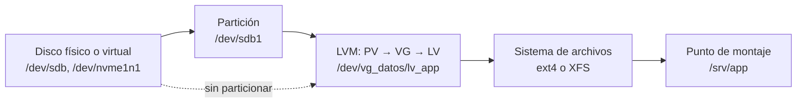

---
tags:
  - servidores
  - linux
  - almacenamiento
  - lvm
---

# Almacenamiento en Linux Server

> Discos, particiones, sistemas de archivos, montaje con fstab, LVM (y cómo ampliar un volumen en caliente), swap, uso de disco, RAID por software, NFS/SMB como cliente y cómo añadir y ampliar discos en AWS, Azure y Google Cloud.

!!! info "Antes de leer"
    Conviene haber leído [Linux Server: fundamentos de administración](linux-fundamentos-servidor.md) (FHS, permisos, systemd). Para los tipos de almacenamiento en la nube (block, file, object) mira [Almacenamiento y datos](../../cloud/redes-y-datos/almacenamiento-datos.md). Las opciones de montaje de seguridad (`nodev`, `nosuid`, `noexec`) están en [Hardening de Linux](../../devsecops/hardening/hardening-linux.md).

!!! note "Cómo se probaron los ejemplos"
    Las salidas son reales y abreviadas. Particiones, LVM, ext4, XFS, `lvextend -r`, `xfs_growfs`, `growpart`, `mkswap`, `fsck` y `findmnt --verify` se probaron en un contenedor Ubuntu 24.04 privilegiado usando **archivos como discos** (dispositivos *loop*) con un filtro de LVM que solo aceptaba esos loops, y se borró todo al terminar. **No se verificaron** (y se describen según la documentación oficial): snapshots de LVM (el kernel de WSL2 no trae `dm-snapshot`), `swapon`, `mdadm` y montajes NFS/SMB reales, porque afectan al kernel compartido o necesitan un servidor.

## ¿Qué es el almacenamiento en un servidor?

Del hardware a la ruta que usa tu aplicación hay varias capas. Entenderlas es lo que te permite ampliar un disco sin parar el servicio:



## Discos y dispositivos

| Comando | Qué muestra |
| --- | --- |
| `lsblk` | Árbol de discos, particiones, LVM y puntos de montaje |
| `lsblk -f` | Lo mismo con sistema de archivos, etiqueta y **UUID** |
| `blkid` | UUID y tipo de cada dispositivo con formato |
| `fdisk -l` / `parted -l` | Tablas de particiones |
| `ls -l /dev/disk/by-id/ /dev/disk/by-uuid/` | Nombres estables (no cambian entre reinicios) |

```bash
lsblk -o NAME,SIZE,TYPE,FSTYPE,MOUNTPOINTS
blkid /dev/vg_datos/lv_app
```

```text
NAME                SIZE TYPE FSTYPE      MOUNTPOINTS
loop2                 1G loop LVM2_member
`-vg_datos-lv_app   1.1G lvm              /srv/app
loop3                 1G loop LVM2_member
|-vg_datos-lv_app   1.1G lvm              /srv/app
`-vg_datos-lv_logs  500M lvm              /var/log/app
/dev/vg_datos/lv_app: LABEL="app" UUID="be5d0146-d7b7-466d-8c8f-6d13ce953def" BLOCK_SIZE="4096" TYPE="ext4"
```

!!! warning "Los nombres /dev/sdX no son estables"
    `/dev/sdb` puede llamarse `/dev/sdc` tras un reinicio o al añadir otro disco, y en la nube los discos NVMe se numeran en el orden en que el kernel los detecta. En `/etc/fstab` y en scripts usa **UUID** o los enlaces de `/dev/disk/by-id/`.

### Tablas de particiones: MBR frente a GPT

| | **MBR** (*Master Boot Record*) | **GPT** (*GUID Partition Table*) |
| --- | --- | --- |
| Tamaño máximo de disco | 2 TiB | Prácticamente ilimitado |
| Particiones | 4 primarias (o extendida + lógicas) | 128 por defecto |
| Redundancia | No | Copia de la tabla al final del disco |
| Arranque | BIOS | UEFI (y BIOS con partición `bios_grub`) |

Usa **GPT** siempre en discos nuevos. Herramientas: `fdisk` (interactiva, MBR y GPT), `gdisk`/`sgdisk` (GPT) y `parted` (scriptable, ideal para automatizar):

```bash
sudo parted -s /dev/sdb mklabel gpt mkpart datos ext4 1MiB 50% mkpart logs xfs 50% 100%
sudo parted -s /dev/sdb unit MiB print
```

```text
Partition Table: gpt
Number  Start    End      Size     File system  Name   Flags
 1      1.00MiB  1024MiB  1023MiB               datos
 2      1024MiB  2047MiB  1023MiB               logs
```

Empezar en `1MiB` deja la partición alineada con los sectores físicos. Tras particionar un disco en uso, el kernel puede no ver la tabla nueva hasta `partprobe` o un reinicio.

!!! tip "¿Particionar o no?"
    En discos de **datos** que van enteros a LVM puedes crear el PV directamente sobre el disco (`pvcreate /dev/sdb`), sin tabla de particiones: ampliar luego es más simple. Algunos equipos prefieren una partición única para que otras herramientas vean que el disco "está en uso"; elige una convención y mantenla.

## Sistemas de archivos

| Sistema | Puntos fuertes | A tener en cuenta | Por defecto en |
| --- | --- | --- | --- |
| **ext4** | Maduro, se puede ampliar **y reducir** (reducir solo desmontado) | Inodos fijados al crear | Ubuntu, Debian |
| **XFS** | Muy bueno con archivos grandes y mucha concurrencia | **No se puede reducir**, solo ampliar | RHEL, Rocky, Alma |
| **Btrfs** | Snapshots, compresión y subvolúmenes nativos | Más complejo de operar | SUSE, Fedora |

```bash
sudo mkfs.ext4 -L app /dev/vg_datos/lv_app     # -L etiqueta
sudo mkfs.xfs -L logs /dev/vg_datos/lv_logs
```

Para revisar y reparar, el sistema de archivos debe estar **desmontado**:

```bash
sudo umount /srv/app
sudo e2fsck -f /dev/vg_datos/lv_app             # ext4 (fsck.ext4)
sudo xfs_repair -n /dev/vg_datos/lv_logs        # XFS: -n = solo revisar, sin cambios
```

```text
e2fsck 1.47.0 (5-Feb-2023)
Pass 1: Checking inodes, blocks, and sizes
Pass 2: Checking directory structure
Pass 3: Checking directory connectivity
Pass 4: Checking reference counts
Pass 5: Checking group summary information
app: 13/288000 files (0.0% non-contiguous), 119722/281600 blocks
```

## Montaje y /etc/fstab

```bash
sudo mount /dev/vg_datos/lv_app /srv/app     # montaje temporal
findmnt /srv/app                             # qué hay montado y con qué opciones
sudo umount /srv/app
```

Para que sobreviva al reinicio, va en `/etc/fstab`. Cada línea tiene seis campos: **qué** (dispositivo), **dónde** (punto de montaje), **tipo**, **opciones**, **dump** (casi siempre 0) y **orden de fsck** (1 para `/`, 2 para el resto, 0 para no revisar).

```text title="/etc/fstab"
# <dispositivo>                            <punto>       <tipo> <opciones>                                   <dump> <fsck>
# Volumen LVM de datos: por UUID; nofail = si falta, el servidor arranca igual
UUID=be5d0146-d7b7-466d-8c8f-6d13ce953def  /srv/app      ext4  defaults,noatime,nofail                      0  2
# XFS: fsck no aplica (se repara con xfs_repair), por eso 0; espera máx. 10 s al disco
UUID=3f2a9c1e-0000-4000-8000-000000000001  /var/log/app  xfs   defaults,nofail,x-systemd.device-timeout=10s 0  0
# Archivo de swap
/swapfile                                  none          swap  sw                                           0  0
# NFS: _netdev = esperar a la red antes de montar
nfs01.ejemplo.internal:/export/datos       /mnt/datos    nfs4  defaults,_netdev,nofail                      0  0
# SMB/CIFS: credenciales en archivo aparte con permisos 600, nunca en fstab
//files01.ejemplo.internal/compartido      /mnt/smb      cifs  credentials=/etc/smb-cred,uid=1001,gid=1002,iocharset=utf8,_netdev,nofail 0 0
```

| Opción | Para qué |
| --- | --- |
| `defaults` | rw, suid, dev, exec, auto, nouser, async |
| `noatime` | No actualiza la fecha de acceso en cada lectura (menos escrituras) |
| `nofail` | Si el dispositivo no está, el arranque sigue (clave en discos de datos y en la nube) |
| `_netdev` | Es un sistema de archivos de red: montarlo después de la red |
| `x-systemd.device-timeout=10s` | Cuánto espera systemd al dispositivo antes de rendirse |
| `ro` | Solo lectura |

**Valida antes de reiniciar** (un fstab roto puede dejar el servidor en `emergency.target`):

```bash
sudo findmnt --verify          # revisa /etc/fstab
sudo mount -a                  # monta todo lo pendiente: si falla aquí, no reinicies
sudo systemctl daemon-reload   # systemd genera units .mount a partir de fstab
```

```text
0 parse errors, 0 errors, 1 warning
   [W] your fstab has been modified, but systemd still uses the old version;
       use 'systemctl daemon-reload' to reload
```

Con un UUID que no existe:

```text
0 parse errors, 2 errors, 0 warnings
/datos
   [E] unreachable on boot required target: No such file or directory
   [E] unreachable on boot required source: UUID=0000-no-existe
```

Detrás de cada línea de fstab, systemd crea una **mount unit** (p. ej. `srv-app.mount`); también puedes escribirlas a mano en `/etc/systemd/system/` cuando necesitas dependencias finas.

## LVM

**LVM** (*Logical Volume Manager*, gestor de volúmenes lógicos) pone una capa entre discos y sistemas de archivos para poder **crecer, mover y combinar** almacenamiento sin reparticionar:

| Capa | Qué es | Comandos |
| --- | --- | --- |
| **PV** (*Physical Volume*) | Un disco o partición preparado para LVM | `pvcreate`, `pvs`, `pvdisplay` |
| **VG** (*Volume Group*) | Bolsa de espacio que suma uno o varios PV | `vgcreate`, `vgextend`, `vgs` |
| **LV** (*Logical Volume*) | "Partición virtual" sacada del VG, donde va el sistema de archivos | `lvcreate`, `lvextend`, `lvs` |

### Crear PV, VG y LV

```bash
sudo pvcreate /dev/sdb /dev/sdc
sudo vgcreate vg_datos /dev/sdb
sudo lvcreate -n lv_app -L 500M vg_datos       # -L tamaño; -l 100%FREE = todo lo libre
sudo pvs; sudo vgs; sudo lvs
```

```text
  Physical volume "/dev/loop2" successfully created.
  Volume group "vg_datos" successfully created
  Logical volume "lv_app" created.
  PV         VG       Fmt  Attr PSize    PFree
  /dev/loop2 vg_datos lvm2 a--  1020.00m 520.00m
  /dev/loop3          lvm2 ---     1.00g   1.00g
  VG       #PV #LV #SN Attr   VSize    VFree
  vg_datos   1   1   0 wz--n- 1020.00m 520.00m
  LV     VG       Attr       LSize   Pool Origin Data%  Meta%  Move Log Cpy%Sync Convert
  lv_app vg_datos -wi-a----- 500.00m
```

El LV aparece como `/dev/vg_datos/lv_app` (enlace a `/dev/mapper/vg_datos-lv_app`).

### Ampliar un LV en caliente

El caso más común en producción: el volumen se llena y hay que crecer **sin desmontar**. Con espacio libre en el VG, basta un comando; `-r` (`--resizefs`) amplía también el sistema de archivos (llama a `resize2fs` o `xfs_growfs`):

```bash
df -h /srv/app                                  # 92 % usado
sudo vgextend vg_datos /dev/sdc                 # si el VG no tiene libre: añade un disco
sudo lvextend -r -L +600M /dev/vg_datos/lv_app  # o -l +100%FREE
df -h /srv/app
```

```text
/dev/mapper/vg_datos-lv_app  452M  381M   37M  92% /srv/app
  Volume group "vg_datos" successfully extended
  Size of logical volume vg_datos/lv_app changed from 500.00 MiB (125 extents) to 1.07 GiB (275 extents).
  Logical volume vg_datos/lv_app successfully resized.
resize2fs 1.47.0 (5-Feb-2023)
Filesystem at /dev/mapper/vg_datos-lv_app is mounted on /srv/app; on-line resizing required
The filesystem on /dev/mapper/vg_datos-lv_app is now 281600 (4k) blocks long.
/dev/mapper/vg_datos-lv_app 1013M  381M  574M  40% /srv/app
```

En XFS, si ampliaste el LV sin `-r`, completa con `xfs_growfs` sobre el **punto de montaje**:

```bash
sudo lvextend -L +200M /dev/vg_datos/lv_logs
sudo xfs_growfs /var/log/app
```

```text
data blocks changed from 76800 to 128000
```

### Snapshots de LVM

Un **snapshot** (instantánea) congela el estado de un LV en un momento, útil antes de una actualización arriesgada. Es *copy-on-write*: solo guarda los bloques que cambian, así que necesita espacio libre en el VG y **se invalida si se llena**.

```bash
sudo lvcreate -s -n lv_app_snap -L 1G /dev/vg_datos/lv_app   # crear snapshot
sudo mount -o ro /dev/vg_datos/lv_app_snap /mnt/snap          # consultarlo
sudo lvconvert --merge vg_datos/lv_app_snap                   # volver atrás (se aplica al reactivar el LV)
sudo lvremove vg_datos/lv_app_snap                            # o descartarlo
```

!!! warning "No verificado en el laboratorio"
    El kernel de WSL2 no incluye el módulo `dm-snapshot` (`snapshot: Required device-mapper target(s) not detected in your kernel`), así que estos comandos se tomaron del manual de `lvcreate(8)`/`lvconvert(8)` y de la documentación de Red Hat. Un snapshot de LVM **no es un backup**: vive en los mismos discos.

## Swap

La **swap** es espacio en disco que el kernel usa cuando falta RAM. Un archivo de swap es lo más flexible:

```bash
sudo fallocate -l 2G /swapfile       # si swapon se queja de "holes", usa dd en su lugar
sudo chmod 600 /swapfile
sudo mkswap /swapfile
sudo swapon /swapfile
swapon --show
echo '/swapfile none swap sw 0 0' | sudo tee -a /etc/fstab
```

```text
Setting up swapspace version 1, size = 256 MiB (268431360 bytes)
no label, UUID=c00974d6-6c22-49bd-85bc-88b605357855
```

Para una **partición** de swap: `mkswap /dev/sdX2` y en fstab `UUID=... none swap sw 0 0`. `vm.swappiness` (0–200, por defecto 60) controla cuánto prefiere el kernel usar swap frente a liberar caché. (En el laboratorio solo se ejecutó `mkswap`; `swapon` no, porque habría activado swap en el kernel compartido de la máquina.)

## Uso de disco

```bash
df -hT                     # espacio por sistema de archivos, con tipo
df -i                      # inodos: "disco lleno" con espacio libre = inodos agotados
du -xh --max-depth=1 /var | sort -rh | head    # qué directorio pesa más (-x: no cruzar a otros FS)
sudo ncdu -x /var          # explorador interactivo (paquete ncdu)
```

```text
810M    /var
718M    /var/lab
62M     /var/lib
30M     /var/log
```

## RAID por software con mdadm

**RAID** (*Redundant Array of Independent Disks*) combina discos para ganar redundancia o rendimiento. En la nube casi nunca lo necesitas (el proveedor ya replica los discos), pero sigue presente en servidores físicos.

| Nivel | Discos mín. | Qué da | Capacidad útil |
| --- | --- | --- | --- |
| RAID 0 | 2 | Rendimiento, **sin** redundancia | Suma |
| RAID 1 | 2 | Espejo | 1 disco |
| RAID 5 | 3 | Paridad, aguanta 1 fallo | n − 1 |
| RAID 6 | 4 | Doble paridad, aguanta 2 fallos | n − 2 |
| RAID 10 | 4 | Espejo + striping | n / 2 |

```bash
sudo mdadm --create /dev/md0 --level=1 --raid-devices=2 /dev/sdb /dev/sdc
cat /proc/mdstat                                  # estado y progreso de sincronización
sudo mdadm --detail /dev/md0
sudo mdadm --detail --scan | sudo tee -a /etc/mdadm/mdadm.conf   # /etc/mdadm.conf en RHEL
sudo update-initramfs -u                          # Ubuntu; en RHEL: dracut -f
```

(No ejecutado en el laboratorio: crearía un dispositivo `md` en el kernel compartido.)

## NFS y SMB/CIFS como cliente

=== "Ubuntu/Debian"

    ```bash
    sudo apt install nfs-common cifs-utils
    ```

=== "RHEL/Rocky"

    ```bash
    sudo dnf install nfs-utils cifs-utils
    ```

```bash
showmount -e nfs01.ejemplo.internal          # exports que ofrece el servidor (NFSv3)
sudo mount -t nfs4 nfs01.ejemplo.internal:/export/datos /mnt/datos
sudo mount -t cifs //files01.ejemplo.internal/compartido /mnt/smb -o credentials=/etc/smb-cred,uid=1001
```

```text title="/etc/smb-cred (chmod 600)"
username=svc_linux
password=CambiaEsto
domain=EJEMPLO
```

Para que monten al arrancar, usa las líneas de fstab con `_netdev,nofail` de arriba. En la nube, los equivalentes gestionados son Amazon EFS (NFS) y FSx, Azure Files (SMB y NFS) y Filestore (NFS). No probado en el laboratorio por falta de servidor NFS/SMB.

## En la nube: añadir y ampliar un disco

El flujo es igual en los tres proveedores: **crear y adjuntar** el disco desde la nube, **identificarlo** dentro de la VM, darle formato y montarlo; para ampliar, **crecer el disco** en la nube y luego **la partición y el sistema de archivos** dentro de la VM.

=== "AWS"

    ```bash
    aws ec2 attach-volume --volume-id vol-0abc123 --instance-id i-0abc123 --device /dev/sdf
    # En instancias Nitro el disco aparece como NVMe (/dev/nvme1n1); identifícalo por el ID del volumen:
    ls -l /dev/disk/by-id/ | grep Elastic_Block_Store
    # Ampliar: Elastic Volumes permite crecer sin desadjuntar
    aws ec2 modify-volume --volume-id vol-0abc123 --size 200
    ```

=== "Azure"

    ```bash
    az vm disk attach -g rg-app --vm-name web01 --name datos01 --new --size-gb 128
    # Enlaces estables por LUN creados por las reglas udev de Azure (p. ej. /dev/disk/azure/scsi1/lun0)
    ls -l /dev/disk/azure/
    # Ampliar (según tipo de disco y VM puede requerir desasignar la VM; revisa la documentación)
    az disk update -g rg-app -n datos01 --size-gb 256
    ```

=== "Google Cloud"

    ```bash
    gcloud compute instances attach-disk web01 --disk datos01 --device-name datos01
    # Enlace estable con el device-name que elegiste:
    ls -l /dev/disk/by-id/google-datos01
    # Ampliar (Persistent Disk e Hyperdisk crecen en caliente)
    gcloud compute disks resize datos01 --size 200GB
    ```

Dentro de la VM, después de ampliar en la nube:

```bash
lsblk                                  # el disco ya muestra el tamaño nuevo; la partición aún no
sudo growpart /dev/nvme0n1 1           # crece la partición 1 (paquete cloud-guest-utils / cloud-utils-growpart)
sudo resize2fs /dev/nvme0n1p1          # ext4
sudo xfs_growfs /                      # XFS: se indica el punto de montaje
# Si hay LVM encima de la partición: growpart → pvresize /dev/nvme0n1p3 → lvextend -r
```

`growpart` probado sobre un archivo de disco:

```text
CHANGED: partition=2 start=2097152 old: size=2095104 end=4192255 new: size=4194271 end=6291422
NOCHANGE: partition 2 is size 4194271. it cannot be grown
```

Ojo con la **sintaxis**: `growpart` recibe el disco y el **número** de partición separados (`/dev/nvme0n1 1`), no `/dev/nvme0n1p1`.

## Casos de uso

### El disco /var está al 95 %

1. Confirma y mira inodos: `df -h /var; df -i /var`.
2. Busca qué crece: `sudo du -xh --max-depth=2 /var | sort -rh | head -15`.
3. Sospechosos habituales: `journalctl --disk-usage` (limpia con `--vacuum-size`), logs sin rotar en `/var/log`, cachés de paquetes (`apt clean`, `dnf clean all`), imágenes de Docker (`docker system df`).
4. Si el espacio no aparece en `du` pero sí en `df`, hay **archivos borrados que siguen abiertos**: `sudo lsof +L1`; reinicia el proceso que los tiene.
5. Si de verdad hace falta más espacio y `/var` es un LV: `lvextend -r`. Más en [Procesos y rendimiento](linux-procesos-rendimiento.md#disco-lleno).

### Añadir un disco de datos a una VM nueva

```bash
sudo pvcreate /dev/nvme1n1
sudo vgcreate vg_datos /dev/nvme1n1
sudo lvcreate -n lv_app -l 100%FREE vg_datos
sudo mkfs.xfs -L app /dev/vg_datos/lv_app
sudo mkdir -p /srv/app
echo "UUID=$(sudo blkid -s UUID -o value /dev/vg_datos/lv_app) /srv/app xfs defaults,nofail 0 0" | sudo tee -a /etc/fstab
sudo findmnt --verify && sudo mount -a && df -h /srv/app
```

Hecho con Ansible: [Ansible para Linux](../ansible/ansible-linux.md) (módulos `community.general.lvg`, `community.general.lvol`, `community.general.filesystem` y `ansible.posix.mount`).

### Ampliar el disco raíz de una VM en la nube

Amplía el volumen en la consola o CLI del proveedor, y dentro: `lsblk` → `growpart` → `resize2fs`/`xfs_growfs` (o `pvresize` + `lvextend -r` si la raíz es LVM, típico en RHEL). No requiere reinicio.

### El servidor arranca en modo emergencia tras tocar fstab

Desde la consola serie: la raíz suele estar en solo lectura, así que `mount -o remount,rw /`, corrige `/etc/fstab` (o comenta la línea), `findmnt --verify`, `systemctl daemon-reload` y `reboot`. Prevención: `nofail` en discos de datos y `findmnt --verify` + `mount -a` antes de reiniciar.

## Problemas comunes

| Síntoma | Causa | Solución |
| --- | --- | --- |
| `No space left on device` con `df` mostrando espacio | Inodos agotados (miles de archivos pequeños) | `df -i`; borra archivos pequeños o recrea el FS con más inodos |
| `df` dice lleno, `du` suma mucho menos | Archivos borrados aún abiertos | `lsof +L1` y reinicia el proceso |
| Tras ampliar el disco en la nube, `df` no cambia | Falta crecer partición y FS | `growpart` + `resize2fs`/`xfs_growfs` |
| `xfs_growfs: /dev/... is not a mounted XFS filesystem` | Le pasaste el dispositivo en vez del punto de montaje (versiones antiguas) | `xfs_growfs /punto/de/montaje` |
| No se puede reducir un LV con XFS | XFS no se reduce | Backup, recrear más pequeño y restaurar |
| El disco "cambió de nombre" tras reiniciar | fstab usa `/dev/sdX` | Usa `UUID=` o `/dev/disk/by-id/` |
| El arranque se queda esperando un disco | Disco de datos ausente sin `nofail` | Añade `nofail` y `x-systemd.device-timeout=` |
| `mount error(13): Permission denied` en CIFS | Credenciales, dominio o versión SMB | Revisa el archivo de credenciales y prueba `vers=3.0` |
| El snapshot de LVM pasó a `Invalid` | Se llenó su espacio copy-on-write | Créalo más grande o elimínalo antes; no es un backup |

## Relación con otras secciones

| Enfoque | Qué se mira desde ahí | Nota |
| --- | --- | --- |
| Cloud (el control) | Discos de bloque, archivos y objetos en la nube; backups y snapshots gestionados | [Almacenamiento y datos](../../cloud/redes-y-datos/almacenamiento-datos.md), [Máquinas virtuales](../../cloud/computo/maquinas-virtuales.md), [Seguridad del almacenamiento](../../cloud/seguridad/seguridad-almacenamiento.md) |
| DevOps (la automatización) | Discos y montajes como código, alertas de disco lleno | [Ansible para Linux](../ansible/ansible-linux.md), [Observabilidad](../../devops/operacion/observabilidad.md), [Troubleshooting](../../devops/operacion/troubleshooting.md) |
| DevSecOps (la verificación) | Opciones de montaje seguras (`nodev`, `nosuid`, `noexec`), cifrado de disco | [Hardening de Linux](../../devsecops/hardening/hardening-linux.md) |
| Servidores | El resto de la administración Linux | [Fundamentos](linux-fundamentos-servidor.md), [Redes](linux-redes-servidor.md), [Procesos y rendimiento](linux-procesos-rendimiento.md) |

## Referencias

- [Red Hat: Configuring and managing logical volumes (RHEL 9)](https://docs.redhat.com/en/documentation/red_hat_enterprise_linux/9/html/configuring_and_managing_logical_volumes/index)
- [Red Hat: Managing file systems (RHEL 9)](https://docs.redhat.com/en/documentation/red_hat_enterprise_linux/9/html/managing_file_systems/index)
- [Ubuntu Server: storage](https://documentation.ubuntu.com/server/how-to/storage/)
- [lvm(8)](https://man7.org/linux/man-pages/man8/lvm.8.html), [lvextend(8)](https://man7.org/linux/man-pages/man8/lvextend.8.html), [fstab(5)](https://man7.org/linux/man-pages/man5/fstab.5.html), [findmnt(8)](https://man7.org/linux/man-pages/man8/findmnt.8.html), [mdadm(8)](https://man7.org/linux/man-pages/man8/mdadm.8.html)
- [AWS: Make an Amazon EBS volume available for use](https://docs.aws.amazon.com/ebs/latest/userguide/ebs-using-volumes.html) y [Extend the file system after resizing a volume](https://docs.aws.amazon.com/ebs/latest/userguide/recognize-expanded-volume-linux.html)
- [Azure: Attach a data disk to a Linux VM](https://learn.microsoft.com/es-es/azure/virtual-machines/linux/attach-disk-portal) y [Expand virtual hard disks on a Linux VM](https://learn.microsoft.com/es-es/azure/virtual-machines/linux/expand-disks)
- [Google Cloud: Format and mount a non-boot disk](https://cloud.google.com/compute/docs/disks/format-mount-disk-linux) y [Resize a persistent disk](https://cloud.google.com/compute/docs/disks/resize-persistent-disk)
