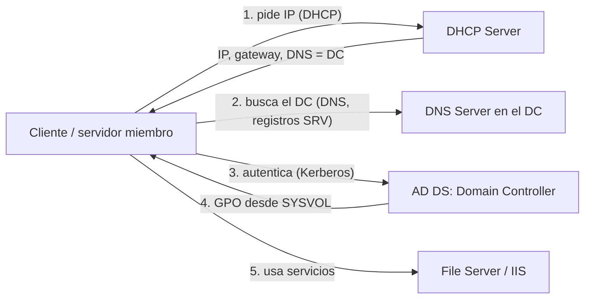
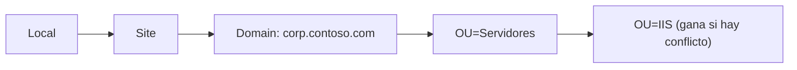

---
tags:
  - servidores
  - windows
  - powershell
  - active-directory
  - redes
---

# Roles y servicios de Windows Server

> Los roles que más vas a ver en una empresa (Active Directory Domain Services, DNS Server, DHCP Server, Group Policy, IIS, File Server y, en una línea, Hyper-V): qué hacen, cómo se instalan con PowerShell, la configuración mínima, cómo verificar que funcionan y sus equivalentes gestionados en la nube.

!!! info "Antes de leer"
    Necesitas saber instalar roles con `Install-WindowsFeature` y administrar en remoto ([Windows Server: fundamentos](windows-server-fundamentos.md)) y manejarte con los comandos del día a día ([Administración con PowerShell](windows-powershell-administracion.md)). Para DNS y DHCP conviene repasar [Servicios de red](../../networking/intermedio/servicios-red.md). El endurecimiento de AD, de los DCs y de IIS **no** se repite aquí: está en [Hardening de Windows Server](../../devsecops/hardening/hardening-windows.md) y [Hardening de servicios](../../devsecops/hardening/hardening-servicios.md).

!!! warning "Sobre las salidas de ejemplo"
    Estos roles **no existen en Windows 11**, así que los cmdlets de los módulos `ADDSDeployment`, `ActiveDirectory`, `DnsServer`, `DhcpServer`, `GroupPolicy`, `WebAdministration` e `IISAdministration` se verificaron contra la documentación de Microsoft Learn (parámetros y ejemplos oficiales) y **no se ejecutaron**. Sus salidas son **esperadas** (formato real del cmdlet, valores de ejemplo con el dominio ficticio `corp.contoso.com`). Las pocas salidas **reales** son de un Windows 11 Home en modo lectura.

## ¿Qué es un rol?

Un **role** (rol) es la función que un servidor ofrece a la red. En una empresa con Windows lo típico es:



Por eso el orden de despliegue suele ser: **AD DS + DNS → DHCP → GPO → servidores de aplicación (IIS, archivos)**.

| Rol | Nombre de la feature | Módulo PowerShell | Consola MMC |
| --- | --- | --- | --- |
| Active Directory Domain Services | `AD-Domain-Services` | `ADDSDeployment`, `ActiveDirectory` | `dsa.msc`, `dsac.exe` |
| DNS Server | `DNS` | `DnsServer` | `dnsmgmt.msc` |
| DHCP Server | `DHCP` | `DhcpServer` | `dhcpmgmt.msc` |
| Group Policy Management | `GPMC` | `GroupPolicy` | `gpmc.msc` |
| Web Server (IIS) | `Web-Server` | `WebAdministration`, `IISAdministration` | `inetmgr` |
| File Server / DFS | `FS-FileServer`, `FS-DFS-Namespace`, `FS-DFS-Replication` | `SmbShare`, `DFSN`, `DFSR` | `fsmgmt.msc`, `dfsmgmt.msc` |
| Hyper-V | `Hyper-V` | `Hyper-V` | `virtmgmt.msc` |

## Active Directory Domain Services

**Active Directory Domain Services** (AD DS) es el directorio de identidades de Windows: usuarios, grupos, equipos y políticas, con autenticación **Kerberos** y **LDAP** para consultas.

| Concepto | Qué es |
| --- | --- |
| **Forest** (bosque) | El límite de seguridad y de esquema; contiene uno o más dominios |
| **Domain** (dominio) | Unidad de administración y replicación (`corp.contoso.com`); nombre NetBIOS corto (`CORP`) |
| **Domain Controller** (DC, controlador de dominio) | Servidor que guarda una copia de la base de datos (`NTDS.dit`) y autentica |
| **OU** (*Organizational Unit*, unidad organizativa) | Carpeta lógica para organizar objetos, **delegar** administración y **vincular GPO** |
| **Functional level** (nivel funcional) | Qué versiones de Windows Server pueden ser DC y qué funciones hay disponibles |
| **FSMO roles** | Cinco funciones únicas (PDC Emulator, RID Master, Infrastructure Master, Schema Master, Domain Naming Master) |
| **SYSVOL** | Carpeta replicada en todos los DCs con scripts y GPO |

Niveles funcionales vigentes: **Windows Server 2025** (solo DCs con Windows Server 2025), **Windows Server 2016** (DCs desde 2016 hasta 2025; 2019 y 2022 no añadieron nivel propio) y Windows Server 2012 R2. Usa el más alto que admitan todos tus DCs.

### Crear un bosque nuevo

En un servidor con IP estática y DNS apuntando a sí mismo o a otro DC:

```powershell
# 1. Instalar el rol (no promueve todavía el servidor a DC)
Install-WindowsFeature -Name AD-Domain-Services -IncludeManagementTools

# 2. Validar sin cambiar nada
Test-ADDSForestInstallation -DomainName 'corp.contoso.com' -InstallDns

# 3. Promover: crea el bosque, instala DNS y reinicia
Install-ADDSForest -DomainName 'corp.contoso.com' -DomainNetbiosName 'CORP' -InstallDns `
  -DatabasePath 'D:\NTDS' -LogPath 'D:\NTDS' -SysvolPath 'D:\SYSVOL'
```

- Sin `-SafeModeAdministratorPassword`, el cmdlet **pide** la contraseña de **DSRM** (*Directory Services Restore Mode*): es la forma recomendada; guárdala en tu gestor de secretos.
- `-InstallDns` es el comportamiento por defecto al crear un bosque. El primer DC queda con `127.0.0.1` como DNS preferido.
- Sin `-ForestMode`/`-DomainMode`, el nivel funcional se calcula automáticamente según la versión del servidor.
- El servidor **se reinicia** al terminar (salvo `-NoRebootOnCompletion`, que Microsoft desaconseja fuera de pruebas).
- Para un **segundo DC** (imprescindible: un único DC es un punto único de fallo) se usa `Install-ADDSDomainController -DomainName corp.contoso.com -InstallDns -Credential (Get-Credential)` en otro servidor.

### OUs, usuarios y grupos

Requiere el módulo `ActiveDirectory` (en el DC, o en tu equipo con RSAT):

```powershell
$base = 'DC=corp,DC=contoso,DC=com'
New-ADOrganizationalUnit -Name 'Servidores' -Path $base -ProtectedFromAccidentalDeletion $true
New-ADOrganizationalUnit -Name 'Usuarios'   -Path $base
New-ADOrganizationalUnit -Name 'Grupos'     -Path $base

New-ADUser -Name 'Ana Pérez' -GivenName 'Ana' -Surname 'Pérez' -SamAccountName 'aperez' `
  -UserPrincipalName 'aperez@corp.contoso.com' -Path "OU=Usuarios,$base" `
  -AccountPassword (Read-Host -AsSecureString 'Contraseña inicial') -ChangePasswordAtLogon $true -Enabled $true

New-ADGroup -Name 'GG-Finanzas' -GroupScope Global -GroupCategory Security -Path "OU=Grupos,$base"
Add-ADGroupMember -Identity 'GG-Finanzas' -Members 'aperez'
```

```powershell
Get-ADUser aperez -Properties MemberOf, LastLogonDate | Select-Object SamAccountName, Enabled, LastLogonDate, MemberOf
```

```text title="Salida esperada"
SamAccountName : aperez
Enabled        : True
LastLogonDate  :
MemberOf       : {CN=GG-Finanzas,OU=Grupos,DC=corp,DC=contoso,DC=com}
```

Patrón clásico de permisos, **AGDLP**: cuentas (**A**ccounts) en grupos **G**lobales por función (`GG-Finanzas`), que se meten en grupos **D**omain **L**ocal por recurso (`DL-Share-Finanzas-RW`), que son los que reciben los **P**ermisos. Así cambiar quién accede a qué es mover usuarios entre grupos, no tocar ACLs.

### Unir un equipo al dominio

En el servidor que se une (DNS apuntando a los DCs):

```powershell
Add-Computer -DomainName 'corp.contoso.com' -OUPath 'OU=Servidores,DC=corp,DC=contoso,DC=com' `
  -Credential (Get-Credential CORP\admin-join) -Restart
```

`-OUPath` evita que el equipo caiga en el contenedor por defecto `CN=Computers` (donde no se pueden vincular GPO). Usa una cuenta delegada solo para unir equipos, no un Domain Admin. Con Ansible: `microsoft.ad.membership` (ver [Ansible y Windows](../ansible/ansible-windows.md)).

### Verificar la salud de AD

```powershell
Get-ADDomainController -Filter * | Select-Object HostName, Site, IPv4Address, OperatingSystem, IsGlobalCatalog
dcdiag /v /c /e /q          # solo errores, todos los DCs
repadmin /replsummary       # estado de replicación entre DCs
netdom query fsmo           # quién tiene los roles FSMO
```

```text title="Salida esperada de repadmin /replsummary (resumida)"
Source DSA          largest delta    fails/total %%   error
 DC01                      08m:12s    0 /   5    0
 DC02                      07m:55s    0 /   5    0
```

Un `error` distinto de 0 o deltas de horas indican replicación rota: revisa DNS (los DCs se encuentran por registros SRV) y la hora (Kerberos tolera 5 minutos de diferencia por defecto).

## DNS Server

En un dominio, DNS es **crítico**: los clientes encuentran los DCs con registros SRV (`_ldap._tcp.dc._msdcs.corp.contoso.com`). Lo normal es instalar DNS en los DCs con **zonas integradas en AD** (*AD-integrated zones*): se replican con AD y admiten **actualizaciones dinámicas seguras**.

```powershell
# Zona directa adicional y zona inversa, replicadas a todos los DCs del bosque
Add-DnsServerPrimaryZone -Name 'apps.contoso.com' -ReplicationScope Forest
Add-DnsServerPrimaryZone -NetworkId '10.0.10.0/24' -ReplicationScope Forest

# Registros
Add-DnsServerResourceRecordA     -ZoneName 'apps.contoso.com' -Name 'intranet' -IPv4Address 10.0.10.30 -CreatePtr
Add-DnsServerResourceRecordCName -ZoneName 'apps.contoso.com' -Name 'www' -HostNameAlias 'intranet.apps.contoso.com'

# Reenviadores para nombres de internet y reenviador condicional hacia la nube
Add-DnsServerForwarder -IPAddress 1.1.1.1, 8.8.8.8
Add-DnsServerConditionalForwarderZone -Name 'privatelink.blob.core.windows.net' -MasterServers 10.50.0.4 -ReplicationScope Forest
```

```powershell
Get-DnsServerResourceRecord -ZoneName 'apps.contoso.com' -RRType A
Resolve-DnsName intranet.apps.contoso.com -Server dc01
```

```text title="Salida esperada de Get-DnsServerResourceRecord"
HostName                  RecordType Type       Timestamp            TimeToLive      RecordData
--------                  ---------- ----       ---------            ----------      ----------
intranet                  A          1          0                    01:00:00        10.0.10.30
```

`Timestamp 0` significa registro **estático** (creado a mano); los dinámicos llevan fecha y los borra el **scavenging** (limpieza de registros obsoletos) si lo activas. El reenviador condicional es la pieza típica de un **DNS híbrido** con la nube (ver [Servicios de red](../../networking/intermedio/servicios-red.md) y [Redes en la nube](../../cloud/redes-y-datos/redes.md)).

## DHCP Server

DHCP reparte IP, máscara, gateway y DNS a los clientes (proceso **DORA**: Discover, Offer, Request, Acknowledge). En un dominio, un servidor DHCP de Windows **debe estar autorizado en AD** o no entregará direcciones (evita servidores DHCP "piratas").

```powershell
Install-WindowsFeature -Name DHCP -IncludeManagementTools
Add-DhcpServerSecurityGroup                                   # crea los grupos locales DHCP Administrators/Users
Restart-Service DHCPServer
Add-DhcpServerInDC -DnsName 'dhcp01.corp.contoso.com' -IPAddress 10.0.10.12

# Ámbito (scope) para 10.0.20.0/24 con exclusión para equipos con IP fija
Add-DhcpServerv4Scope -Name 'Oficina-Piso2' -StartRange 10.0.20.50 -EndRange 10.0.20.250 `
  -SubnetMask 255.255.255.0 -LeaseDuration 8.00:00:00 -State Active
Set-DhcpServerv4OptionValue -ScopeId 10.0.20.0 -Router 10.0.20.1 -DnsServer 10.0.10.10, 10.0.10.11 -DnsDomain 'corp.contoso.com'

# Reserva: la impresora siempre recibe la misma IP (ClientId = MAC)
Add-DhcpServerv4Reservation -ScopeId 10.0.20.0 -IPAddress 10.0.20.60 -ClientId '00-15-5D-0A-1B-2C' -Name 'IMP-PISO2'
```

```powershell
Get-DhcpServerv4Scope
Get-DhcpServerv4ScopeStatistics
```

```text title="Salida esperada"
ScopeId         SubnetMask      Name           State    StartRange      EndRange        LeaseDuration
-------         ----------      ----           -----    ----------      --------        -------------
10.0.20.0       255.255.255.0   Oficina-Piso2  Active   10.0.20.50      10.0.20.250     8.00:00:00

ScopeId         Free            InUse           PercentageInUse Reserved Pending
-------         ----            -----           --------------- -------- -------
10.0.20.0       176             25              12,43           1        0
```

- `-LeaseDuration` usa el formato `días.horas:minutos:segundos` (por defecto 8 días).
- Si `PercentageInUse` se acerca al 100 %, los clientes nuevos se quedan con APIPA (169.254.x.x).
- Alta disponibilidad: **DHCP failover** entre dos servidores (`Add-DhcpServerv4Failover`), en modo *load balance* o *hot standby*.
- Si el DHCP está en otra subred, el router necesita un **DHCP relay** (*IP helper*). En la nube no despliegas DHCP: lo da la plataforma (ver [Servicios de red](../../networking/intermedio/servicios-red.md)).

## Group Policy

Una **GPO** (*Group Policy Object*) es un conjunto de configuraciones (seguridad, registro, scripts, software, firewall) que se aplica a equipos y usuarios de un sitio, dominio u OU.

### Precedencia LSDOU

Se aplican en orden **L**ocal → **S**ite → **D**omain → **OU** (de la OU padre a la hija); si dos GPO configuran lo mismo, **gana la última**. Dos modificadores:

- **Enforced** (forzada) en un vínculo superior: no la puede sobrescribir una GPO inferior.
- **Block Inheritance** (bloquear herencia) en una OU: ignora las GPO de arriba, salvo las *Enforced*.

Además, el **security filtering** (por defecto *Authenticated Users*) y los **WMI filters** deciden a qué objetos concretos se aplica.



### Crear, vincular y verificar

```powershell
New-GPO -Name 'SRV - RDP con NLA' -Comment 'Exige NLA en RDP para servidores'
Set-GPRegistryValue -Name 'SRV - RDP con NLA' `
  -Key 'HKLM\SOFTWARE\Policies\Microsoft\Windows NT\Terminal Services' -ValueName 'UserAuthentication' -Type DWord -Value 1
New-GPLink -Name 'SRV - RDP con NLA' -Target 'OU=Servidores,DC=corp,DC=contoso,DC=com' -LinkEnabled Yes

Get-GPInheritance -Target 'OU=Servidores,DC=corp,DC=contoso,DC=com'   # qué GPO llegan a la OU y en qué orden
Backup-GPO -All -Path '\\fs01\backups\gpo'                             # copia antes de cambios
```

En el equipo destino:

```powershell
gpupdate /force                         # aplica ya (si no, cada 90 min ± 30 en miembros; 5 min en DCs)
gpresult /r /scope computer             # resumen de GPO aplicadas y filtradas (elevado)
gpresult /h C:\temp\gpresult.html       # informe completo
```

```text title="Salida real de gpresult /r /scope user (Windows 11 Home, fuera de dominio, anonimizada)"
Herramienta de resultados para la Directiva de grupos del
sistema operativo Microsoft (R) Windows (R) v2.0

RSOP datos para EQUIPO\usuario en EQUIPO : modo de inicio de sesión
```

En un equipo de dominio verás además *Objetos de directiva de grupo aplicados* y *Se filtraron los siguientes GPO* con el motivo (filtro de seguridad, WMI, vínculo deshabilitado). Las baselines de seguridad que se distribuyen por GPO están en [Hardening de Windows Server](../../devsecops/hardening/hardening-windows.md#gpo-y-su-alcance).

## IIS

**Internet Information Services** (IIS) es el servidor web de Windows: sitios estáticos, ASP.NET, ASP.NET Core (con el *Hosting Bundle*) y proxy inverso (con ARR).

| Concepto | Qué es |
| --- | --- |
| **Site** (sitio) | Carpeta física + uno o más bindings |
| **Binding** | Combinación protocolo + IP + puerto + host header (`https/*:443:intranet.contoso.com`) |
| **Application pool** | Proceso aislado (`w3wp.exe`) con su identidad y su versión de runtime; separa apps para que una caída no tumbe las demás |
| **ApplicationPoolIdentity** | Identidad virtual por pool (`IIS AppPool\NombrePool`), la opción por defecto y la recomendada |

```powershell
Install-WindowsFeature -Name Web-Server, Web-Asp-Net45 -IncludeManagementTools

Import-Module WebAdministration
New-Item -Path 'C:\inetpub\intranet' -ItemType Directory
New-WebAppPool -Name 'IntranetPool'
Set-ItemProperty 'IIS:\AppPools\IntranetPool' -Name managedRuntimeVersion -Value ''   # sin CLR: ASP.NET Core o estático
New-Website -Name 'Intranet' -PhysicalPath 'C:\inetpub\intranet' -ApplicationPool 'IntranetPool' `
  -Port 80 -HostHeader 'intranet.contoso.com'
```

Con el módulo más moderno **IISAdministration** (ejemplo oficial de Microsoft Learn):

```powershell
New-IISSite -Name 'TestSite' -BindingInformation '*:443:' -PhysicalPath "$env:SystemDrive\inetpub\testsite" `
  -CertificateThumbPrint 'D043B153FCEFD5011B9C28E186A60B9F13103363' -CertStoreLocation 'Cert:\LocalMachine\Webhosting' -Protocol https
```

Verificar:

```powershell
Get-Website
Get-IISAppPool
Invoke-WebRequest -Uri 'http://localhost' -Headers @{ Host = 'intranet.contoso.com' } -UseBasicParsing | Select-Object StatusCode
```

```text title="Salida esperada de Get-Website"
Name             ID   State      Physical Path                  Bindings
----             --   -----      -------------                  --------
Default Web Site 1    Started    %SystemDrive%\inetpub\wwwroot  http *:80:
Intranet         2    Started    C:\inetpub\intranet            http *:80:intranet.contoso.com
```

- `WebAdministration` usa el *drive* `IIS:\` y funciona en PowerShell 5.1; en PowerShell 7 cárgalo vía compatibilidad o usa `IISAdministration`.
- Los logs están en `C:\inetpub\logs\LogFiles\W3SVC<ID>` (formato W3C): vigílalos, llenan discos.
- Un error **503** suele ser el application pool detenido (por fallos repetidos: *Rapid-Fail Protection*). Mira `Get-IISAppPool` y el log System (eventos de WAS).
- TLS, cabeceras y endurecimiento de IIS: [Hardening de servicios](../../devsecops/hardening/hardening-servicios.md).

## File Server

El rol **File and Storage Services** con `FS-FileServer` publica carpetas por **SMB**. La creación de shares y la lógica share + NTFS están en [Administración con PowerShell](windows-powershell-administracion.md#archivos-compartidos-smb); aquí lo propio del servidor:

```powershell
Install-WindowsFeature -Name FS-FileServer, FS-Resource-Manager -IncludeManagementTools

New-SmbShare -Name 'Finanzas' -Path 'D:\Shares\Finanzas' -FullAccess 'CORP\DL-Share-Finanzas-RW' `
  -FolderEnumerationMode AccessBased -CachingMode None
Get-SmbSession | Select-Object ClientComputerName, ClientUserName, NumOpens   # quién está conectado
Get-SmbOpenFile | Where-Object Path -like 'D:\Shares\Finanzas*'                 # qué archivos tiene abiertos
```

- **FSRM** (*File Server Resource Manager*): cuotas por carpeta y bloqueo de tipos de archivo (por ejemplo, ejecutables en un share de documentos).
- **DFS** en una línea: **DFS Namespaces** da una ruta única (`\\corp.contoso.com\datos`) que apunta a shares en varios servidores, y **DFS Replication** los mantiene sincronizados entre sedes.
- Shadow copies (*Volume Shadow Copy Service*) permiten a los usuarios recuperar versiones anteriores, pero **no son backup**.

## Hyper-V

**Hyper-V** es el hipervisor de Windows Server (`Install-WindowsFeature -Name Hyper-V -IncludeManagementTools -Restart`, módulo `Hyper-V` con `New-VM`, `Get-VM`, `Checkpoint-VM`); en la nube no lo usarás salvo virtualización anidada, porque la VM ya es la unidad de cómputo.

## Equivalentes gestionados en la nube

| Necesidad | AWS | Azure | Google Cloud |
| --- | --- | --- | --- |
| AD gestionado (DCs que opera el proveedor) | **AWS Directory Service for Microsoft Active Directory** (*AWS Managed Microsoft AD*): AD real en dos AZ, con trust hacia tu AD on-premise | **Microsoft Entra Domain Services**: dominio gestionado sincronizado desde Microsoft Entra ID, sin acceso de Domain Admin | **Managed Service for Microsoft Active Directory** |
| DNS | Route 53 (Resolver endpoints para híbrido) | Azure DNS (Private Resolver para híbrido) | Cloud DNS (forwarding zones) |
| DHCP | Lo da la VPC (DHCP option sets) | Lo da la VNet | Lo da la VPC |
| Archivos SMB | Amazon FSx for Windows File Server | Azure Files | Filestore (NFS); SMB con NetApp Volumes |
| Web | IIS en EC2, o Elastic Beanstalk / App Runner | IIS en VM, o Azure App Service | IIS en Compute Engine, o Cloud Run |

Microsoft Entra ID (antes Azure AD) **no** es un AD en la nube: es un proveedor de identidad para aplicaciones web (OIDC, SAML) y no tiene OUs, GPO ni Kerberos clásico. Ver [IAM: AWS, Azure y GCP](../../cloud/identidad-y-seguridad/iam-comparativa.md).

## Casos de uso

### 1. Laboratorio: dominio nuevo con un DC, DNS y DHCP

1. VM con Windows Server 2025, IP estática `10.0.10.10`, nombre `DC01` ([fundamentos](windows-server-fundamentos.md#lo-mismo-con-powershell-repetible-y-automatizable)).
2. `Install-WindowsFeature AD-Domain-Services -IncludeManagementTools` y `Install-ADDSForest -DomainName corp.contoso.com -InstallDns`.
3. Tras el reinicio: `Get-ADDomain`, `dcdiag /q` y `Resolve-DnsName _ldap._tcp.dc._msdcs.corp.contoso.com -Type SRV`.
4. Rol DHCP, `Add-DhcpServerInDC`, ámbito con opción DNS = `10.0.10.10`.
5. Un cliente recibe IP, se une con `Add-Computer` y aparece en `Get-ADComputer -Filter *`.

### 2. Añadir un servidor al dominio y ponerle su GPO

1. DNS del servidor apuntando a los DCs (`Set-DnsClientServerAddress`).
2. `Add-Computer -DomainName corp.contoso.com -OUPath 'OU=IIS,OU=Servidores,...' -Restart`.
3. En el servidor: `gpupdate /force` y `gpresult /r /scope computer` para confirmar que la GPO de la OU se aplicó.
4. Si no aparece: comprueba la OU real del equipo (`Get-ADComputer SRV-WEB01`), el vínculo (`Get-GPInheritance`) y el filtrado de seguridad.

### 3. Publicar una intranet en IIS con HTTPS

1. `Install-WindowsFeature Web-Server -IncludeManagementTools`.
2. Importa el certificado al almacén `Cert:\LocalMachine\My` (o `WebHosting`).
3. Crea el pool y el sitio (`New-WebAppPool`, `New-Website` o `New-IISSite ... -Protocol https -CertificateThumbPrint ...`).
4. Registro DNS `intranet` en la zona interna (`Add-DnsServerResourceRecordA`).
5. Regla de firewall 443 limitada a la red interna y prueba con `Test-NetConnection intranet.contoso.com -Port 443` y `Invoke-WebRequest`.

### 4. Los clientes de una planta no reciben IP

1. En un cliente: `Get-NetIPAddress` → `169.254.x.x` (APIPA) confirma que no hubo respuesta DHCP.
2. En el servidor: `Get-DhcpServerv4ScopeStatistics` → ¿`PercentageInUse` al 100 %? Amplía rango o baja `LeaseDuration`.
3. ¿El servidor sigue autorizado? `Get-DhcpServerInDC`.
4. ¿El ámbito está activo? `Get-DhcpServerv4Scope` → `State`.
5. Si el DHCP está en otra subred, revisa el *DHCP relay* del router de esa planta.

### 5. Un usuario no puede entrar: "la relación de confianza entre esta estación de trabajo y el dominio principal falló"

El canal seguro del equipo con el dominio se rompió (por ejemplo, tras restaurar un snapshot antiguo de la VM). Con una cuenta local de administrador: `Test-ComputerSecureChannel -Repair -Credential (Get-Credential CORP\admin-join)`. Evita restaurar snapshots de DCs sin entender cómo afecta a la replicación (Windows Server moderno detecta el *VM-GenerationID*, pero no es un plan de backup).

## Problemas comunes

| Síntoma | Causa | Solución |
| --- | --- | --- |
| No se puede unir un equipo al dominio ("no se pudo contactar con un controlador de dominio") | El equipo usa un DNS público o del router, no el de AD | DNS del cliente = IPs de los DCs; prueba `Resolve-DnsName _ldap._tcp.dc._msdcs.<dominio> -Type SRV` |
| Errores de Kerberos, "the time difference..." | Reloj desincronizado (> 5 min) | El PDC Emulator sincroniza con una fuente fiable; el resto con la jerarquía del dominio (`w32tm /query /status`) |
| `Install-ADDSForest` falla en las comprobaciones previas | IP dinámica, contraseña DSRM débil, nombre de dominio de una sola etiqueta | Ejecuta antes `Test-ADDSForestInstallation` y corrige lo que indique |
| DHCP instalado pero no entrega IPs | Servidor no autorizado en AD o ámbito inactivo | `Add-DhcpServerInDC`; `Get-DhcpServerv4Scope` |
| La GPO no se aplica | Equipo en otra OU, vínculo deshabilitado, filtrado de seguridad o WMI, o *Block Inheritance* | `gpresult /h` muestra el motivo exacto de cada GPO filtrada |
| La GPO "aplica" pero el valor no cambia | Configuración de equipo vs de usuario, o necesita reinicio/cierre de sesión | Revisa la sección correcta y reinicia si la política lo exige |
| IIS devuelve 503 | Application pool detenido por fallos repetidos | `Get-IISAppPool`, eventos de WAS en System, log de la app; corrige y `Start-WebAppPool` |
| IIS devuelve 404 con el host correcto | El binding no coincide (host header, puerto o IP) | `Get-WebBinding -Name Intranet` |
| Share accesible por IP pero no por nombre (o al revés) | DNS o SPN/Kerberos (por IP se usa NTLM) | Accede por nombre DNS; revisa el registro A y los SPN si usas alias (`setspn -L`) |

## Relación con otras secciones

| Enfoque | Qué se mira desde ahí | Nota |
| --- | --- | --- |
| Servidores (la práctica) | Instalar roles, comandos de administración y automatizarlo | [Windows Server: fundamentos](windows-server-fundamentos.md), [Administración con PowerShell](windows-powershell-administracion.md), [Ansible y Windows](../ansible/ansible-windows.md), [Ansible: casos de uso](../ansible/ansible-casos-uso.md) |
| Networking (la base) | DHCP, DNS, resolución híbrida y segmentación | [Servicios de red](../../networking/intermedio/servicios-red.md), [Redes de datacenter e híbridas](../../networking/avanzado/redes-datacenter-hibridas.md), [Puertos](../../recursos/puertos.md) |
| Cloud (el control) | AD, DNS y archivos gestionados; identidad en la nube | [IAM: AWS, Azure y GCP](../../cloud/identidad-y-seguridad/iam-comparativa.md), [Redes en la nube](../../cloud/redes-y-datos/redes.md), [Almacenamiento y datos](../../cloud/redes-y-datos/almacenamiento-datos.md) |
| DevOps (la automatización) | Roles y configuración como código | [Configuration management con Ansible](../../devops/iac/ansible.md) |
| DevSecOps (la verificación) | Endurecer AD, DCs e IIS; vulnerabilidades típicas del dominio | [Hardening de Windows Server](../../devsecops/hardening/hardening-windows.md), [Hardening de servicios](../../devsecops/hardening/hardening-servicios.md), [CVE en Windows y Active Directory](../../devsecops/vulnerabilidades/cve-windows-active-directory.md) |

## Referencias

- [Install-ADDSForest](https://learn.microsoft.com/en-us/powershell/module/addsdeployment/install-addsforest) e [Install-ADDSDomainController](https://learn.microsoft.com/en-us/powershell/module/addsdeployment/install-addsdomaincontroller)
- [Niveles funcionales de AD DS](https://learn.microsoft.com/es-es/windows-server/identity/ad-ds/active-directory-functional-levels)
- [Módulo ActiveDirectory](https://learn.microsoft.com/en-us/powershell/module/activedirectory/)
- [Add-Computer](https://learn.microsoft.com/es-es/powershell/module/microsoft.powershell.management/add-computer)
- [Módulo DnsServer](https://learn.microsoft.com/en-us/powershell/module/dnsserver/)
- [Add-DhcpServerv4Scope](https://learn.microsoft.com/en-us/powershell/module/dhcpserver/add-dhcpserverv4scope) y [módulo DhcpServer](https://learn.microsoft.com/en-us/powershell/module/dhcpserver/)
- [Implementar DHCP con PowerShell](https://learn.microsoft.com/es-es/windows-server/networking/technologies/dhcp/quickstart-install-configure-dhcp-server)
- [Módulo GroupPolicy](https://learn.microsoft.com/en-us/powershell/module/grouppolicy/) y [gpresult](https://learn.microsoft.com/es-es/windows-server/administration/windows-commands/gpresult)
- [New-IISSite (IISAdministration)](https://learn.microsoft.com/en-us/powershell/module/iisadministration/new-iissite) y [módulo WebAdministration](https://learn.microsoft.com/en-us/powershell/module/webadministration/)
- [Información general de DFS Namespaces](https://learn.microsoft.com/es-es/windows-server/storage/dfs-namespaces/dfs-overview)
- [Microsoft Entra Domain Services](https://learn.microsoft.com/es-es/entra/identity/domain-services/overview)
- [AWS Managed Microsoft AD](https://docs.aws.amazon.com/directoryservice/latest/admin-guide/directory_microsoft_ad.html)
- [Managed Service for Microsoft Active Directory (Google Cloud)](https://cloud.google.com/managed-microsoft-ad/docs/overview)
